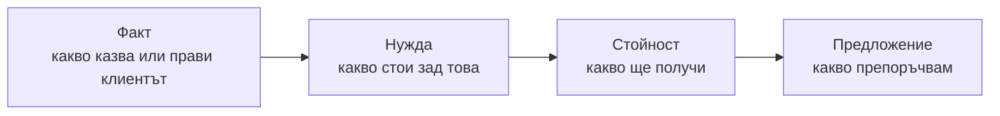
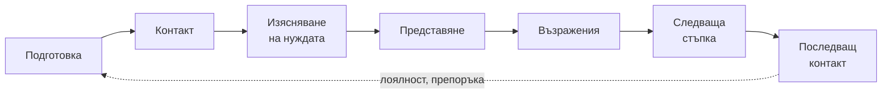
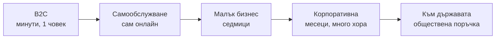

# Модул 01. Продажбата като процес на създаване на стойност

## Цели на урока

След този урок ученикът може да:

* разграничи продажба, продуктово представяне и транзакция;
* опише каква стойност получава клиентът и каква бизнесът;
* разграничи продажбата на различни нива: B2C, самообслужване, малък бизнес, корпоративна, чрез партньори и към държавата;
* подреди основните етапи на продажбения процес;
* обясни ролята на доверието във всеки етап.

## 1. Входен казус: „Добра оферта, лоша продажба“

Мартин влиза в Технополис за слушалки за тренировка. Консултантът веднага му показва най-скъпия модел: шумопотискане, 40 часа батерия, шест микрофона. Говори пет минути. Мартин излиза без да купи нищо.

Офертата беше добра. Продуктът беше качествен. Защо тогава няма продажба?

Консултантът не попита нищо. Не разбра, че Мартин тича в парка, иска да чува колите около себе си и бюджетът му е до 80 евро. Шумопотискането, с което се гордееше консултантът, за Мартин е недостатък.

> **Опитай сам.** Спомни си последния път, когато някой се опита да ти продаде нещо и ти отказа. Запиши три реда: какво ти предложиха, какво всъщност ти трябваше и в кой момент реши, че няма да купиш.

## 2. Три понятия, които често се бъркат

**Transaction (транзакция)** е самата размяна: плащаш, получаваш продукт. Касовата бележка е доказателство за транзакция. Тя може да се случи и без продавач, например в машина за кафе или на каса на самообслужване в Lidl.

**Product presentation (продуктово представяне)** е разказ за продукта: какво има, какво прави, колко струва. Представянето е за продукта.

**Sale (продажба)** е процесът, в който продавачът разбира какво е нужно на клиента и му помага да вземе добро решение. Продажбата е за клиента. Транзакцията е само нейният последен, видим резултат.

| | Транзакция | Продуктово представяне | Продажба |
|---|---|---|---|
| В центъра е | плащането | продуктът | клиентът и неговата нужда |
| Въпросът е | „Как ще платите?“ | „Вижте какво може“ | „За какво ще го ползвате?“ |
| Може ли без продавач | да | да (видео, сайт) | трудно |

> **Опитай сам.** Класифицирай: (1) поръчваш пица от приложението на Domino's; (2) консултант в A1 ти обяснява новия iPhone на щанда; (3) служител в Praktiker те пита за какво ти е бормашината и ти препоръчва по-евтин модел. Коя е транзакция, коя представяне и коя продажба?

## 3. Стойност за клиента и стойност за бизнеса

**Customer value (стойност за клиента)** е разликата между това, което клиентът получава, и това, което дава. Дава не само пари, а и време, усилия и риск.

**Business value (стойност за бизнеса)** е това, което фирмата получава: приход, печалба, доволен клиент, който се връща и препоръчва.

Добрата продажба създава стойност и за двете страни. Ако продадеш на клиента нещо, което не му трябва, бизнесът печели днес и губи утре: връщане на стоката, лошо ревю в Google, клиент, който не се връща.

### Карта факт, нужда, стойност

Това е първият ни инструмент. Започваме от наблюдаем факт, търсим нуждата зад него и чак тогава мислим за стойността.

| Факт (какво виждам или чувам) | Нужда (какво стои зад това) | Стойност (какво ще получи клиентът) |
|---|---|---|
| „Тичам в парка всяка сутрин.“ | безопасност, да чува колите | слушалки с прозрачен режим, по-малък риск |
| „До 80 евро.“ | да не надхвърли бюджета | ясна покупка без съжаление |
| „Предните ми паднаха от ушите.“ | стабилно стоене при движение | спокойствие по време на тренировка |

> **Опитай сам.** Попълни картата за себе си като клиент на телефон. Напиши три факта за това как ползваш телефона, нуждата зад всеки и стойността, която би търсил в нов модел.

## 4. Етапите на продажбения процес

Продажбата не е един разговор, а поредица от стъпки. В различните книги ще ги срещнеш с различни имена, но логиката е една и съща.

1. **Preparation (подготовка).** Какво знам за клиента и продукта, преди да започнем?
2. **Contact (контакт).** Първите секунди: поздрав, тон, внимание.
3. **Needs discovery (изясняване на потребността).** Въпроси и слушане.
4. **Presentation (представяне на решение).** Само това, което отговаря на нуждата.
5. **Objections (възражения).** Колебания, въпроси, „скъпо е“.
6. **Closing (договаряне на следваща стъпка).** Покупка, пробен период, среща, оферта.
7. **Follow-up (последващ контакт).** Проверка дали клиентът е доволен.

Най-честата грешка е прескачането на етап 3. Консултантът от казуса скочи от контакт направо към представяне.

## 5. Доверието във всеки етап

**Trust (доверие)** е очакването, че другият ще действа в твой интерес или поне няма да ти навреди. В продажбите доверието се гради бавно и се губи за секунди.

| Етап | Какво гради доверие | Какво го разрушава |
|---|---|---|
| Подготовка | знаеш продукта и условията | объркваш цени и наличности |
| Контакт | спокоен поздрав, внимание | натрапване, телефон в ръка |
| Нужда | въпроси, слушане | прекъсване, предположения |
| Представяне | честност, и за ограниченията | преувеличени обещания |
| Възражения | спокойствие, уточняване | спор, натиск |
| Следваща стъпка | ясно договорено действие | изкуствена спешност („само днес“) |
| Последващ контакт | проверка след покупката | изчезване след плащането |

### Пример

Магазин за велосипеди в Пловдив дава на всеки клиент безплатна настройка след първия месец. Собственикът казва, че половината продажби идват от препоръки на хора, дошли на тази настройка. Последващият контакт гради доверие и то носи нови клиенти.

> **Опитай сам.** Минисимулация в тройки: продавач, клиент, наблюдател. Клиентът иска раница за училище. Наблюдателят попълва наблюдателския лист от задачите: в кой етап продавачът спечели доверие и в кой го загуби.

## 6. Продажбата на различни нива

Продажбата на слушалки и продажбата на AI система за банка следват една и съща логика: нужда, стойност, доверие. Но изглеждат съвсем различно, защото е различно **кой купува** и **колко сложно е решението**.

| Ниво | Кой купува | Колко трае | Колко души решават | Пример |
|---|---|---|---|---|
| **B2C (бизнес към потребител)** | човек за себе си | минути до дни | 1 до 2 | маратонки в магазин |
| **Self-serve, PLG (самообслужване, растеж чрез продукта)** | човек или екип, сам онлайн | минути | 1 | безплатен план в Lovable, после абонамент с карта |
| **SMB (малък и среден бизнес)** | собственик, управител | седмици | 1 до 3 | касова система за кафене |
| **Enterprise (корпоративна продажба)** | голяма организация | месеци | 6 до 20 | Salesforce или Claude for Enterprise за банка |
| **Channel (чрез партньори)** | купува от посредник | зависи | зависи | Claude през AWS, Google Cloud и Microsoft; Nike през Sport Depot |
| **B2G (към държавата)** | институция | месеци | комисия | обществена поръчка за училищни лаптопи |

Колкото по-сложно е решението, толкова по-важни стават етапите подготовка, изясняване на нуждата и последващ контакт. В корпоративната продажба продавачът трябва да разбере не една, а много нужди: на човека, който ще ползва продукта, на шефа му, на ИТ отдела, на юристите, на финансовия директор.

### Пример от голяма компания: Anthropic продава на всички нива

Anthropic продава Claude едновременно като безплатно и платено приложение за отделни хора, като планове за екипи, като API за разработчици и чрез облачните платформи на Amazon, Google и Microsoft. Често продажбата започва отдолу: разработчик пробва, екипът му започва да го ползва, после компанията иска договор със сигурност и контрол върху данните. Тогава влизат корпоративните продавачи. Около 80% от приходите на компанията са от бизнес клиенти. Подробен анализ има в [Как продават големите](#/golemite).

> **Опитай сам.** Избери продукт, който познаваш (Spotify, Canva, Lovable, iPhone). Опиши как би изглеждала продажбата му на три нива: на ученик, на малка фирма и на голяма компания. Какво се променя в нуждата, в хората, които решават, и в доказателствата, които искат?

## Въпроси за дискусия

1. Може ли да има продажба без транзакция? А транзакция без продажба? Дай пример за двете.
2. Защо продавач, който продава на клиента нещо ненужно, вреди на собствения си бизнес?
3. Кой етап от продажбения процес ти се струва най-труден и защо?

## Ключови термини

| Термин | Превод |
|---|---|
| Sale | продажба |
| Transaction | транзакция, размяна |
| Product presentation | продуктово представяне |
| Customer value | стойност за клиента |
| Needs discovery | изясняване на потребността |
| Follow-up | последващ контакт |
| Trust | доверие |
| B2C, B2B, B2G | бизнес към потребител, към бизнес, към държавата |
| Enterprise sales | корпоративни продажби |
| Product-led growth (PLG) | растеж, воден от продукта |
