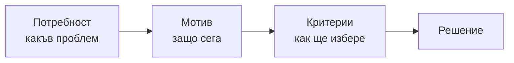

# Модул 02. Клиентът и решението за покупка

| Час | Дата | Тема | Вид |
|---|---|---|---|
| 3 | 07.10.2026 | Потребност, мотив и критерий за избор | Нови знания |
| 4 | 14.10.2026 | Различна стойност за различни клиенти | Упражнение |
| 5 | 21.10.2026 | Подготовка на кратък клиентски профил | Практическа работа |

## Цели на урока

След този урок ученикът може да:

* разпознае потребност, мотив и критерий за избор;
* отдели наблюдаем факт от предположение за клиента;
* обясни защо един и същ продукт носи различна стойност на различни хора;
* изгради кратък клиентски профил само с релевантни данни и проверими хипотези.

## 1. Три думи, които обясняват всяка покупка

**Need (потребност)** е проблемът или липсата, която клиентът иска да реши. „Трябва ми лаптоп за училище.“

**Motive (мотив)** е причината, която го движи да действа сега. „Старият се счупи и в понеделник имам проект.“ Мотивът може да е практичен, емоционален или социален: удобство, сигурност, статус, принадлежност към група.

**Buying criterion (критерий за избор)** е мярката, по която клиентът ще сравнява вариантите. „Да е лек, батерията да издържа целия ден и да е до 700 евро.“

Двама клиенти могат да имат една и съща потребност и съвсем различни критерии. Затова продавачът, който знае само потребността, още не знае достатъчно.

> **Опитай сам.** Помисли за последната си по-голяма покупка: телефон, обувки, абонамент. Запиши потребността, мотива и трите си най-важни критерия. Кой критерий реши избора накрая?

## 2. Факт или предположение?

Продавачът вижда клиента за минута и вече има мнение за него. Опасността е да вземе мнението си за факт.

**Fact (факт)** е нещо, което можем да видим, чуем или проверим. „Каза, че кара колело всеки ден.“

**Assumption (предположение)** е наш извод, който може да е грешен. „Облечен е скъпо, значи цената няма значение.“

Предположенията не са забранени. Те са полезни, ако ги превърнем във въпрос.

### Таблица „знаем, предполагаме, питаме“

| Знаем (факт) | Предполагаме | Питаме, за да проверим |
|---|---|---|
| Дойде с дете на около 6 години | Търси нещо за детето | „За вас ли търсите или за малкия?“ |
| Държи стария си телефон с напукан екран | Ще иска здрав калъф | „Какво се случи с този? Често ли пада?“ |
| Каза „нямам много време“ | Иска кратко решение | „Кое е най-важното, за да решим бързо?“ |

> **Опитай сам.** Анализирай три клиентски ситуации от задачите. За всяка попълни таблицата. Колко от „фактите“ ти всъщност са предположения?

## 3. Един продукт, различна стойност

Вземи абонамент за Spotify Premium. За ученичка, която слуша музика по пътя за училище, стойността е без реклами и офлайн слушане. За родител, който плаща Family план, стойността е, че цялото семейство има музика на една сметка. За шофьор на такси стойността е, че не губи връзка в тунела.

Продуктът е един. Стойността е различна, защото критериите са различни.

### Пример: два клиента, един лаптоп

| | Клиент А: ученик в 11. клас | Клиент Б: графичен дизайнер на свободна практика |
|---|---|---|
| Потребност | лаптоп за училище и игри | машина за работа с клиенти |
| Мотив | старият е бавен, идва проект | нов голям клиент от следващия месец |
| Критерии | цена до 900 евро, видеокарта, тегло | точен цвят на екрана, мощност, сервиз до 24 часа |
| Какво е стойност | играе и учи на една машина | не губи пари от спрял лаптоп |

Ако продавачът говори на ученика за сервиз до 24 часа, губи вниманието му. Ако говори на дизайнера за игри, губи доверието му.

> **Опитай сам.** Сравнителен казус: Технополис продава една прахосмукачка робот. Клиент 1 е възрастен човек, който живее сам в апартамент. Клиент 2 е семейство с куче и три деца. Напиши за всеки двата най-важни критерия и една аргументирана препоръка.

## 4. Клиентският профил

**Customer profile (клиентски профил)** е кратко описание на конкретен клиент, което помага да се подготвим за разговора. Не е досие. Влиза само това, което е полезно за продажбата и е получено по честен начин.

Добрият профил има пет части:

1. **Кой е:** роля, ситуация (не лични подробности, които не ни трябват);
2. **Потребност:** какъв проблем решава;
3. **Мотив:** защо сега;
4. **Критерии:** по какво ще избира;
5. **Хипотези и въпроси:** какво предполагаме и как ще го проверим.

**Hypothesis (хипотеза)** е предположение, записано така, че да може да се провери. Не „той е стиснат“, а „предполагаме, че цената е първият му критерий; ще попитаме какъв бюджет е заложил“.

### Правилото на източника

За всяко твърдение в профила записваме откъде го знаем: казал го е клиентът, видели сме го, прочели сме го в публична страница на фирмата. Ако няма източник, то е хипотеза и отива в колоната с въпроси.

> **Опитай сам.** Работен лист „Клиентски профил“ от задачите. Избери ученическа фирма, кафене или магазин близо до училището като клиент на твоята услуга. Попълни профила и защити източника на всяко твърдение пред съседа си по чин.

## Въпроси за дискусия

1. Защо е опасно продавачът да реши, че знае какво иска клиентът още преди да е попитал?
2. Кои данни за клиента не бива да влизат в профила, дори ако ги знаем?
3. Дай пример, в който мотивът е по-важен от потребността.

## Ключови термини

| Термин | Превод |
|---|---|
| Need | потребност |
| Motive | мотив |
| Buying criteria | критерии за избор |
| Assumption | предположение |
| Hypothesis | хипотеза, проверимо предположение |
| Customer profile | клиентски профил |
