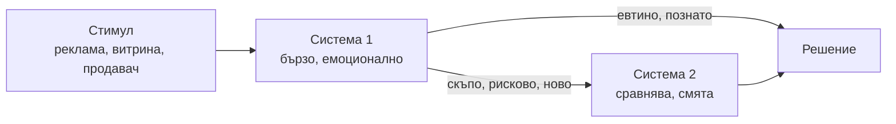
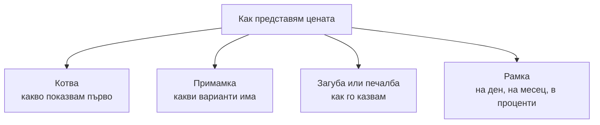

# Модул 03. Психология на решението за покупка

## Цели на урока

След този урок ученикът може да:

* обясни защо хората не решават само логично;
* разпознае седемте принципа на влиянието на Робърт Чалдини в реални продажби;
* разпознае котва, примамка, страх от загуба и рамка в цени и оферти;
* разграничи етичното използване на тези принципи от манипулацията.

## 1. Две системи за мислене

Психологът Даниел Канеман, носител на Нобелова награда за икономика, описва два начина, по които мислим.

**System 1 (система 1)** е бърза, автоматична, емоционална. Тя решава дали харесваш опаковката, дали продавачът ти е симпатичен, дали „всички“ купуват това.

**System 2 (система 2)** е бавна, внимателна, логична. Тя сравнява цени, чете условия, смята.

Повечето покупки започват в система 1. Система 2 се включва, когато покупката е скъпа, рискована или нова. Затова клиентът често решава с емоцията и после оправдава решението с логика.

**Какво значи това за продавача.** Не е достатъчно да имаш логични аргументи. Първото впечатление, доверието и усещането са също толкова важни. Но не бива да заобикаляш система 2 при важни решения: клиентът, който е купил на емоция и после е пресметнал, че е сбъркал, връща продукта и не се връща.

> **Опитай сам.** Спомни си последната си импулсивна покупка и последната обмислена. Кое реши покупката във всяка: емоция, навик, сравнение, съвет?

## 2. Седемте принципа на Чалдини

Робърт Чалдини изследва десетилетия наред защо хората казват „да“. В книгата си „Влиянието“ описва шест принципа, а по-късно добавя седми.

| Принцип | Какво значи | Етичен пример | Манипулация |
|---|---|---|---|
| **Reciprocity (взаимност)** | връщаме услуга за услуга | безплатна мостра в Lidl, безплатен урок | „подарък“, след който те притискат да купиш |
| **Commitment and consistency (ангажимент и последователност)** | искаме да сме последователни с това, което сме казали | „Казахте, че качеството е най-важно за вас…“ | изтръгваш малко „да“, за да хванеш човека в капан |
| **Social proof (социално доказателство)** | правим това, което правят другите | реални отзиви, „най-продаван в магазина този месец“ | измислени отзиви, купени последователи |
| **Authority (авторитет)** | вярваме на експерти | сертификат, независим тест, опитен консултант | актьор в бяла престилка, който „препоръчва“ |
| **Liking (харесване)** | купуваме от хора, които харесваме | искрен интерес, общи теми | фалшиво приятелство |
| **Scarcity (недостиг)** | искаме това, което е рядко | „Остават 3 бройки“, ако е вярно | брояч, който се рестартира |
| **Unity (единство)** | вярваме на „нашите“ | местен бизнес, общност на клиенти | „само за избрани“, когато всеки е „избран“ |

### Пример от голяма компания: Виктория Бекъм и списъкът на чакащите

Фон дьо тенът Foundation Drops на Victoria Beckham Beauty тръгва със списък от 25 000 чакащи. Това използва едновременно **недостиг** (не всеки може да го купи веднага), **социално доказателство** (25 000 души го искат) и **харесване** (самата Виктория показва как го нанася). Етично е, докато списъкът е истински и продуктът отговаря на обещанието.

> **Опитай сам.** Намери в магазин или онлайн по един пример за поне четири от принципите. Запиши дали според теб е етично и защо.

## 3. Поведенческа икономика в цените

**Behavioural economics (поведенческа икономика)** изучава как хората реално вземат икономически решения, с всичките си грешки и навици.

### Котва (anchoring)

Първото число, което чуем, става отправна точка. Ако видиш, че якето „струваше 240 евро“, сега е 160, 160 ти изглежда изгодно, дори ако никога не би дал 160 за яке. Продавач, който показва първо скъпия модел, поставя котва.

### Примамка (decoy effect)

Добавя се вариант, който никой не купува, за да изглежда друг вариант по-изгоден.

| Пуканки в кино | Цена |
|---|---|
| малки | 4 евро |
| средни | 6,50 евро |
| големи | 7 евро |

Средните са примамката: никой не ги иска, но заради тях големите изглеждат „почти без пари отгоре“.

### Страх от загуба (loss aversion)

Хората се притесняват повече да не изгубят нещо, отколкото се радват да спечелят същото. „Спестявате 50 евро“ действа по-слабо от „губите 50 евро всяка година, ако останете със стария план“.

### Рамка (framing)

Едно и също, казано по различен начин. „95% без мазнини“ звучи по-добре от „5% мазнини“. „1 евро на ден“ звучи по-лесно от „365 евро на година“.

**Етичното правило е същото като в модул 15:** използваш тези ефекти, за да представиш вярна информация ясно, не за да скриеш истината. Котва с измислена „стара цена“ е заблуждаваща търговска практика. В ЕС при обявяване на намаление магазинът трябва да посочи като предишна цена най-ниската цена през последните 30 дни.

> **Опитай сам.** Отвори страницата с абонаменти на Spotify, Netflix или мобилен оператор. Има ли котва? Примамка? Как е рамкирана цената (на месец, на година, на човек)?

## 4. Как го правят големите

### Пример от голяма компания: Apple и котвата

Apple обикновено показва моделите един до друг, от най-скъпия към най-евтиния, с ясно отбелязани разлики. Скъпият модел е котвата, а средният започва да изглежда разумен. Мнозина купуват средния, който е и най-изгоден за компанията. Всичко е вярно и видимо. Това е пример за котва, използвана открито.

### Пример от голяма компания: Lovable и взаимността

Lovable дава на всеки безплатни кредити, с които да направи първото си приложение. Човек, който е получил нещо полезно, е по-склонен да плати, когато му трябва повече. Ръководителката на растежа Елена Верна казва, че даването на продукта безплатно работи по-добре от платената реклама.

## Въпроси за дискусия

1. Ако всеки продавач знае тези принципи, как клиентът може да се защити?
2. Къде е границата между недостиг и изкуствена спешност?
3. Защо измислените отзиви вредят не само на клиента, но и на цялата платформа?

## Ключови термини

| Термин | Превод |
|---|---|
| Behavioural economics | поведенческа икономика |
| Anchoring | котва, ефект на котвата |
| Decoy effect | ефект на примамката |
| Loss aversion | страх от загуба |
| Framing | рамкиране |
| Social proof | социално доказателство |
| Scarcity | недостиг |
| Reciprocity | взаимност |

## Източници

* Cialdini, R. Influence: The Psychology of Persuasion, разширено издание 2021.
* Kahneman, D. Thinking, Fast and Slow, 2011.
* Директива 98/6/ЕО, изменена с Директива (ЕС) 2019/2161, за обявяване на намаления.
