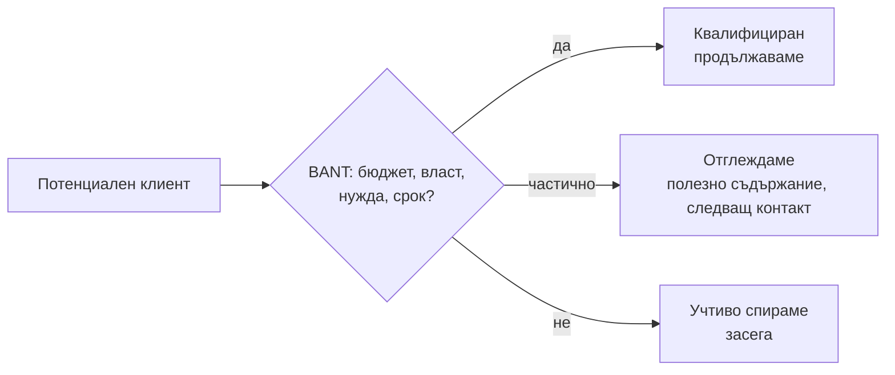

# Модул 04. Търсене на клиенти и квалифициране

## Цели на урока

След този урок ученикът може да:

* опише профил на идеалния клиент (ICP) за конкретен бизнес;
* разграничи входящо и изходящо търсене на клиенти;
* напише персонализирано студено съобщение, което уважава получателя;
* провери дали потенциалният клиент е реален с BANT и MEDDIC.

## 1. Откъде идват клиентите

Досега клиентът идваше сам в магазина. В много продажби обаче продавачът трябва първо да намери клиента. Това се нарича **prospecting (търсене на потенциални клиенти)**.

| Вид | Как работи | Пример |
|---|---|---|
| **Inbound (входящо)** | клиентът идва сам, защото те е намерил | попълва форма на сайта, пише в Instagram, обажда се след реклама |
| **Outbound (изходящо)** | продавачът се свързва пръв | студен имейл, обаждане, съобщение в LinkedIn, посещение на място |
| **Referral (препоръка)** | доволен клиент те препоръчва | „Иван каза, че сте му направили сайта“ |
| **Product-led (чрез продукта)** | хората ползват безплатния продукт и стигат до продавача | Lovable, Canva, Slack |
| **Partners (партньори)** | друг продава заедно с теб | Claude през облака на Amazon, Google или Microsoft |

**Lead (потенциален клиент)** е всеки, който може да купи. **Qualified lead (квалифициран потенциален клиент)** е този, за когото сме проверили, че има смисъл да продаваме.

## 2. Профил на идеалния клиент

**ICP, Ideal Customer Profile (профил на идеалния клиент)** описва фирмата или човека, за когото продуктът ти носи най-много стойност и който най-вероятно ще купи. Разликата с персоната от модул 02: персоната е човек, а ICP при бизнес клиенти обикновено описва фирма.

### Пример: фирма за уеб сайтове в Пловдив

| Критерий | Идеален клиент |
|---|---|
| Отрасъл | ресторанти, салони, ремонтни услуги |
| Размер | 2 до 20 служители |
| Място | Пловдив и региона |
| Сигнал за нужда | няма сайт или сайтът не работи на телефон; много отзиви в Google, но без онлайн записване |
| Кой решава | собственикът |
| Бюджет | 600 до 2 000 евро |

**Signal (сигнал)** е видим знак, че клиентът може да има нужда сега: нов обект, наемане на хора, лоши отзиви за бавно обслужване, стар сайт.

> **Опитай сам.** Напиши ICP за услуга, която ти или твоят клас бихте могли да предложите (снимки за малки бизнеси, управление на Instagram, уроци). Добави поне два сигнала за нужда.

## 3. Студеното съобщение

**Cold outreach (студен контакт)** е първото съобщение до човек, който не те познава. Повечето такива съобщения се трият след 3 секунди. Добрите имат пет части:

1. **Лично начало:** нещо конкретно за получателя, което показва, че си се подготвил.
2. **Проблем или възможност:** с думите на клиента, не с думите на продукта.
3. **Доказателство:** един кратък пример или резултат.
4. **Лесна следваща стъпка:** малка молба, не „купете“.
5. **Кратко:** до 80 думи.

### Пример

**Тема:** Онлайн записване за салона на ул. Капитан Райчо

„Здравейте, г-жо Петрова! Видях, че салонът ви има над 300 отзива в Google с оценка 4,8, а записването е само по телефона. Работим с няколко салона в Пловдив, при които онлайн записването е намалило пропуснатите часове. Имате ли 15 минути следващата седмица, за да ви покажа как изглежда? Ако не е актуално, просто ми кажете и няма да ви пиша повече.

Мария, ученическа фирма „Уеб Старт“, СУ „…““

Последното изречение е важно: уважава правото на човека да откаже.

### Какво казва законът

Изпращането на рекламни имейли до хора без тяхното съгласие е ограничено от европейските правила за защита на данните и електронните съобщения. При бизнес контакти и при съобщения, които не са масова реклама, а персонализирано запитване, правилата са по-гъвкави, но винаги трябва: да кажеш кой си, откъде имаш контакта и как човек може да откаже. Масови писма до списъци с купени адреси са незаконни и вредят на името ти.

> **Опитай сам.** Напиши студено съобщение до местно кафене с предложение ученическият ви клас да направи снимки на менюто им за Instagram. Използвай петте части. Брой думите.

## 4. Квалифициране: струва ли си?

Продавачът има ограничено време. Ако го харчи за хора, които няма да купят, губи. **Qualification (квалифициране)** е проверка дали един потенциален клиент е реален.

### BANT

Най-простата рамка, създадена в IBM:

| Буква | На английски | Въпрос |
|---|---|---|
| **B** | Budget (бюджет) | Има ли пари за това? |
| **A** | Authority (власт за решение) | Този човек ли решава или трябва да убедим и друг? |
| **N** | Need (нужда) | Има ли реален проблем, който решаваме? |
| **T** | Timeline (срок) | Кога иска да реши? |

### MEDDIC

За големи корпоративни сделки се използва по-подробна рамка. Тя е създадена в компанията PTC през 90-те години и днес я ползват много технологични фирми.

| Буква | Какво проверяваме |
|---|---|
| **M**etrics (метрики) | Какъв измерим резултат очаква клиентът? |
| **E**conomic buyer (икономически купувач) | Кой реално подписва и плаща? |
| **D**ecision criteria (критерии за решение) | По какво ще сравняват? |
| **D**ecision process (процес на решение) | Какви стъпки и одобрения има? |
| **I**dentify pain (болката) | Какъв е проблемът и колко струва? |
| **C**hampion (вътрешен защитник) | Кой в компанията вярва в нас и ни помага отвътре? |

### Пример от голяма компания: квалифициране при Anthropic и Salesforce

Когато голяма банка пита за Claude for Enterprise или за Agentforce на Salesforce, продавачът не започва с презентация. Първо проверява по MEDDIC: какъв резултат очакват (по-бързо обслужване на клиенти, по-малко ръчна работа), кой подписва (често финансовият директор), какво ще иска отделът за сигурност, колко трае одобрението и кой вътре в банката е застъпникът. Корпоративната продажба може да отнеме месеци и без това квалифициране продавачът може да загуби половин година.

> **Опитай сам.** Провери по BANT три ситуации от задачите и реши: продължаваме, отглеждаме или спираме.

## Въпроси за дискусия

1. Защо „всеки е наш клиент“ е лоша стратегия?
2. Кога студеното съобщение е полезно за получателя и кога е спам?
3. Защо понякога е по-професионално продавачът сам да спре да продава на някого?

## Ключови термини

| Термин | Превод |
|---|---|
| Prospecting | търсене на потенциални клиенти |
| Lead / qualified lead | потенциален / квалифициран потенциален клиент |
| Inbound / outbound | входящо / изходящо |
| Ideal Customer Profile (ICP) | профил на идеалния клиент |
| Cold outreach | студен контакт |
| Qualification | квалифициране |
| BANT, MEDDIC | рамки за квалифициране |
| Champion | вътрешен защитник |
