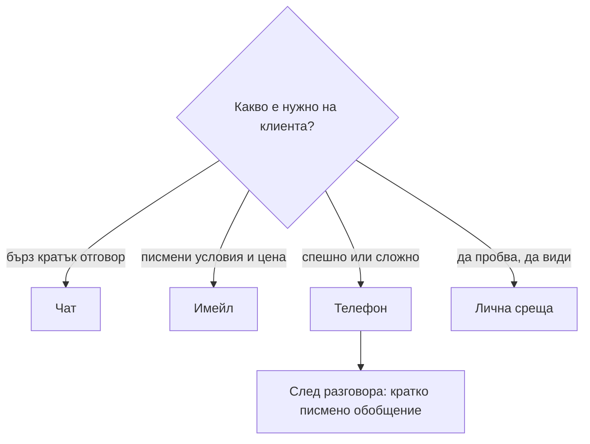

# Модул 05. Комуникация и доверие в продажбите

## Цели на урока

След този урок ученикът може да:

* обясни как тонът, езикът и поведението влияят на клиента;
* разпознае невербален сигнал, без да го приема за сигурно доказателство;
* преформулира непрофесионална реплика в професионална;
* избере подходящ канал (чат, имейл, телефон, лично) според ситуацията.

## 1. Първите секунди

Клиентът решава дали ти има доверие много преди да чуе цената. Влиза в магазина и вижда двама служители, които си говорят и не го поглеждат. Или пише в чата на онлайн магазин и получава отговор след два дни. Още не е видял продукта, но вече има мнение за фирмата.

**First impression (първо впечатление)** се формира от няколко неща едновременно:

* **внимание:** забелязваш ли клиента, оставяш ли телефона;
* **тон:** спокоен, приятелски, без досада;
* **език:** ясни думи, без жаргон и без фамилиарничене;
* **поведение:** поза, дистанция, усмивка, която не е насилена.

> **Опитай сам.** Влез в два магазина в квартала (или в два онлайн чата) и запиши първите 30 секунди: колко време мина, докато някой те забележи, какво ти казаха и как се почувства. Сравни.

## 2. Тон и език: преформулиране

Едно и също съдържание може да звучи като помощ или като обида.

| Непрофесионално | Професионално | Какво промених |
|---|---|---|
| „Не знам, не е мой отдел.“ | „Ще проверя с колегата и след минута съм при вас.“ | поемам отговорност |
| „Нали ви казах, няма наличност.“ | „За съжаление в момента няма. Мога да проверя в другия ни магазин или да ви уведомя, когато дойде.“ | предлагам следваща стъпка |
| „Евтино е, вземете го.“ | „В рамките на бюджета ви е и покрива двете неща, които споменахте.“ | свързвам с нуждата |
| „Бро, този е топ.“ | „Този модел се харесва на хора, които търсят същото като вас.“ | уважителен регистър |

**Register (регистър)** е степента на официалност на езика. С връстник в чат можем да сме по-неформални. С клиент започваме с „Вие“ и преминаваме на „ти“ само ако той го предложи.

> **Опитай сам.** Преформулирай: „Аз какво да направя, като куриерът закъснява?“ и „Това е, ако не ви харесва, гледайте другаде.“

## 3. Невербалното поведение: внимание с изводите

**Nonverbal behaviour (невербално поведение)** са сигналите без думи: поза, жестове, мимика, дистанция, поглед.

Тук има капан. В популярни статии ще прочетеш, че скръстените ръце означават защита, а погледът встрани значи лъжа. Изследванията не потвърждават такива сигурни правила. Скръстените ръце може да значат, че на човека му е студено. Погледът встрани може да е мислене.

**Правилото е:** невербалният сигнал е повод за въпрос, не доказателство.

| Сигнал | Грешен извод | Професионална реакция |
|---|---|---|
| Клиентът гледа часовника | „Не се интересува.“ | „Искате ли да ви кажа най-важното накратко?“ |
| Мълчи дълго | „Не му харесва.“ | изчакваш; после „Какво мислите?“ |
| Връща се за трети път към един продукт | „Вече е решил.“ | „Виждам, че този ви прави впечатление. Какво ви харесва в него?“ |

### Пример

Служител в магазин на Vivacom вижда клиентка, която се мръщи, докато чете договора. Не решава, че е недоволна от цената. Пита: „Има ли нещо, което да ви обясня?“ Оказва се, че просто е забравила очилата си. Служителят ѝ чете важните точки на глас и продажбата завършва.

> **Опитай сам.** Гледай 2 минути видео без звук от реклама или интервю. Запиши какви „сигнали“ виждаш. После пусни звука. Колко от изводите ти се потвърдиха?

## 4. Подходящ канал

Днес клиентът може да пише в Instagram, да звънне, да прати имейл, да ползва чата на сайта или да дойде на място. Всеки канал има силни и слаби страни.

| Канал | Силно | Слабо | Подходящ за |
|---|---|---|---|
| Чат (сайт, Messenger, Viber) | бърз, удобен | лесно се разбира погрешно | кратки въпроси, наличност |
| Имейл | остава следа, може подробно | бавен | оферти, условия, потвърждения |
| Телефон | глас, тон, бърза реакция | няма писмена следа | спешни и сложни въпроси |
| Лично | най-много сигнали, доверие | изисква време | важни решения, пробване |

Добра практика е важните неща, договорени по телефона, да се потвърдят писмено. Така и двете страни помнят едно и също.

> **Опитай сам.** Една ситуация, три канала. Клиент иска да разбере дали може да върне обувки, купени онлайн преди 10 дни. Напиши отговор в чат (до 3 изречения), в имейл (с поздрав и подпис) и сценарий за телефон (първите 3 реплики).

## 5. Професионалното общуване в четири думи

Ясно, уважително, конкретно, навреме.

* **Ясно:** клиентът разбира какво следва, без да пита отново.
* **Уважително:** тонът не се променя, дори ако клиентът е раздразнен.
* **Конкретно:** вместо „скоро“ казваш „до петък“.
* **Навреме:** отговор в разумен срок за канала. В чат клиентът очаква минути, в имейл до един работен ден.

## 6. Как го правят големите

### Пример от голяма компания: Apple Store

В магазините на Apple можеш да пробваш всичко колкото искаш, без някой да те гони. Консултантите не работят на комисиона от продажбата, затова не са притиснати да ти продадат най-скъпото. Плащаш при самия консултант, без опашка на каса. Има безплатни уроци и сервиз в същия магазин.

Всичко това е подредено около първото впечатление и доверието: клиентът първо се чувства добре дошъл, а после купува.

> **Опитай сам.** Сравни първите 60 секунди в магазин за техника в твоя град с описанието на Apple Store. Кои три неща би променил в местния магазин?

## Въпроси за дискусия

1. Кога е по-добре да не пишеш на клиента, а да му звъннеш?
2. Защо е опасно да „четеш“ клиента по езика на тялото?
3. Какво прави едно съобщение да звучи професионално, дори ако е кратко?

## Ключови термини

| Термин | Превод |
|---|---|
| First impression | първо впечатление |
| Tone of voice | тон |
| Register | регистър, степен на официалност |
| Nonverbal behaviour | невербално поведение |
| Communication channel | комуникационен канал |
| Feedback | обратна връзка |
