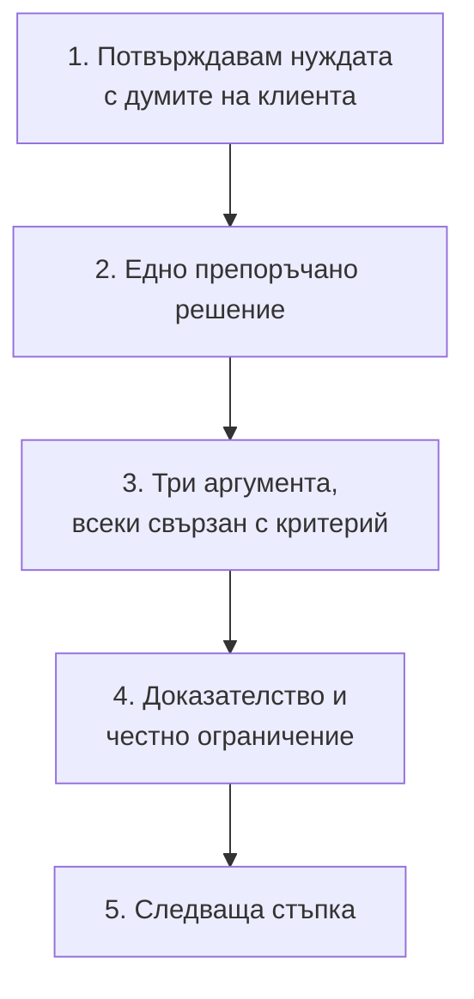

# Модул 06. Представяне и препоръчване на решение

## Цели на урока

След този урок ученикът може да:

* отсее релевантната информация от продуктовия шум;
* структурира предложение около нуждата на клиента;
* представи решение на разбираем език и да го свърже с заявен критерий;
* сравни алтернативи по общи критерии, без да прикрива ограниченията.

## 1. Продуктовият шум

Отвори страницата на който и да е телевизор в Технополис или eMAG. Ще видиш 60 реда технически данни: HDR10+, 120 Hz, Dolby Atmos, HDMI 2.1, VRR. Повечето хора не знаят какво значи половината от тях и не им трябва да знаят.

**Product noise (продуктов шум)** е цялата информация, която е вярна, но не помага на този клиент да реши. Шумът уморява. Уморен клиент казва „ще помисля“ и си тръгва.

### Казус: претоварената оферта

Фирма за уеб дизайн праща на собственичката на салон за красота оферта от 9 страници: технологии, история на фирмата, 14 вида пакети, условия за хостинг. Собственичката е питала само едно: „Може ли клиентките да си запазват час онлайн и колко ще струва?“ Тя не отговаря на имейла.

Как изглежда същата оферта на една страница:

1. **Вашата нужда:** онлайн записване за час, за да не ви звънят по време на работа.
2. **Три аргумента:** записване от телефона 24 часа; автоматично напомняне по SMS, което намалява пропуснатите часове; плащате веднъж за сайта и 15 евро месечно за системата.
3. **Цена и срок:** 600 евро, готово за 3 седмици.
4. **Следваща стъпка:** 20 минути разговор в четвъртък, за да ви покажем как изглежда.

> **Опитай сам.** Вземи описание на продукт от онлайн магазин (поне 15 реда). Съкрати го до три аргумента и една следваща стъпка за конкретен клиент, когото си измислиш с едно изречение.

## 2. Структура на предложението

Използвай логиката от модул 05, но сега за целия разговор.

**Правилото на трите:** хората запомнят до три аргумента. Ако имаш пет, избери трите, които отговарят на най-важните критерии на клиента.

**Разбираем език:** заменяме техническия термин с това, което клиентът ще почувства.

| Технически | Разбираемо |
|---|---|
| „120 Hz опресняване“ | „картината е гладка при футбол и игри, без да се размазва“ |
| „IP68“ | „няма проблем, ако падне в мивката или под дъжда“ |
| „SSD 1 TB“ | „пали за секунди и има място за около 200 000 снимки“ |

## 3. Представяне според критерия

Представянето винаги се връща към това, което клиентът е казал. Използвай фразите-мостове:

* „Казахте, че…, затова…“
* „Понеже за вас е важно…, обърнете внимание на…“
* „Това отговаря на въпроса ви за…“

### Непълна информация

Понякога не знаеш достатъчно, за да препоръчаш. Тогава имаш право и задължение да попиташ още, преди да препоръчаш. Препоръка на сляпо е предположение, облечено като съвет.

> **Опитай сам.** Ролева задача от задачите: клиентът дава само половината информация. Продавачът има право на до три допълнителни въпроса преди препоръката. Наблюдателят записва дали въпросите бяха нужни и дали препоръката се свърза с критерий.

## 4. Сравняване на алтернативи

Клиентите сравняват винаги: с конкурента, с по-евтиния модел, с това да не купят нищо. Добрият продавач не се страхува от сравнението, а го прави вместо клиента. Честно.

### Сравнителна таблица

Сравняваме по критериите на клиента, не по всички възможни данни.

| Критерий на клиента | Вариант А | Вариант Б | Вариант В |
|---|---|---|---|
| цена до 500 евро | 449 евро ✓ | 529 евро ✗ | 399 евро ✓ |
| лек за носене | 1,4 кг ✓ | 1,1 кг ✓ | 1,9 кг ✗ |
| батерия за учебен ден | 10 ч ✓ | 14 ч ✓ | 6 ч ✗ |
| **Извод** | пасва на всички критерии | най-добър, но над бюджета | евтин, но не издържа деня |

### Аргументиран компромис

**Trade-off (компромис)** е, когато печелиш в едно и губиш в друго. Почти всяко решение има компромис. Да го кажеш на клиента гради доверие.

„Вариант Б има по-дълга батерия, но е 29 евро над бюджета ви. Ако батерията е най-важна, си струва. Ако бюджетът е твърд, А покрива всичко, което ми казахте.“

Така клиентът решава сам, с цялата информация. Това е продажба, която не носи съжаление след покупката.

### Пример

В много вериги за техника консултантите показват и по-евтин модел, когато той отговаря на нуждата на клиента. Клиентът, който е спестил пари по съвет на продавача, се връща при него за следващата покупка.

> **Опитай сам.** Направи сравнителна таблица на три телефона (реални модели, цени от сайт на магазин) по три критерия на измислен клиент. Подготви минипрезентация до 2 минути с препоръка и един аргументиран компромис.

## 5. Как го правят големите

### Пример от голяма компания: какво сравнява клиентът

Малка фирма иска приложение за записване на часове. Алтернативите ѝ са: да наеме програмист, да ползва готова платформа или да го направи сама с Lovable. Добрият продавач на Lovable не крие ограниченията. Сравнението по критериите на клиента може да изглежда така:

| Критерий | Програмист | Готова платформа | Lovable |
|---|---|---|---|
| първа версия | седмици | дни | часове до дни |
| пълен контрол върху всичко | да | не | частично |
| нужни технически умения | не (за клиента) | не | малко |
| сложни интеграции | да | ограничено | зависи от случая |

**Аргументиран компромис:** „Ако ви трябва бързо и искате сами да променяте, Lovable е по-подходящ. Ако приложението ще се свързва със сложна вътрешна система, може да ви трябва и програмист.“

> **Опитай сам.** Направи такава таблица за избор между Canva, Photoshop и дизайнер на свободна практика за ученическа фирма.

## Въпроси за дискусия

1. Защо повече информация може да намали шанса за продажба?
2. Трябва ли продавачът да показва на клиента и по-евтиния вариант, ако той пасва? Защо?
3. Как звучи честно казан компромис и как звучи прикрит?

## Ключови термини

| Термин | Превод |
|---|---|
| Product noise | продуктов шум |
| Recommendation | препоръка |
| Alternative | алтернатива |
| Comparison table | сравнителна таблица |
| Trade-off | компромис |
| Next step | следваща стъпка |
