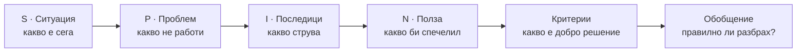

# Модул 06. Въпроси и активно слушане

## Цели на урока

След този урок ученикът може да:

* разграничи отворени, затворени и уточняващи въпроси;
* подбере въпрос според това каква информация му трябва;
* подреди въпросите по модела SPIN: ситуация, проблем, последици, полза;
* използва перифразиране, уточняване и обобщение и да търси потвърждение от клиента.

## 1. Защо въпросите продават повече от отговорите

Продавачът, който говори през цялото време, научава само това, което вече знае. Продавачът, който пита, научава това, което му трябва, за да предложи точното решение. Освен това клиентът, който е бил изслушан, вярва повече на препоръката.

Въпросите имат три задачи: да събират информация, да помагат на клиента сам да подреди мислите си и да показват, че ни интересува.

## 2. Видове въпроси

**Open question (отворен въпрос)** не може да се отговори с „да“ или „не“. Започва с „какво“, „как“, „защо“, „разкажете“. Дава много информация.
„Как ползвате лаптопа си в един обикновен ден?“

**Closed question (затворен въпрос)** има кратък отговор: да, не, число, избор. Полезен е за проверка и уточняване.
„Бюджетът ви до 700 евро ли е?“

**Clarifying question (уточняващ въпрос)** разкрива какво точно стои зад нещо, което клиентът вече е казал.
„Казахте, че искате да е бърз. Бърз за какво точно, за игри или за отваряне на много програми?“

| Вид | Кога го ползваме | Риск |
|---|---|---|
| Отворен | в началото, за да разберем ситуацията | ако е твърде общ, клиентът не знае какво да каже |
| Затворен | за проверка, за решение | ако са много, звучи като разпит |
| Уточняващ | когато чуем обща дума („хубав“, „качествен“, „бърз“) | никакъв, ако е зададен спокойно |

### Въпроси, които вредят

* **Leading question (подвеждащ въпрос)** подсказва отговора: „Нали искате най-добрия модел?“
* **Неясен въпрос:** „Какво мислите изобщо?“
* **Двоен въпрос:** „За работа ли ви трябва и колко искате да платите?“ Клиентът отговаря само на едната част.

> **Опитай сам.** Редактирай: (1) „Нали не искате да ви се развали след година?“; (2) „Как е, кажете?“; (3) „За вас ли е и кога ви трябва?“. Напиши нова версия и защо е по-добра.

## 3. Карта цел, въпрос, доказателство

Преди да зададем въпрос, добре е да знаем каква информация търсим и как ще разберем, че сме я получили.

| Цел: какво искам да разбера | Въпрос | Доказателство: какво ще чуя |
|---|---|---|
| за какво ще ползва продукта | „Разкажете ми как ще го ползвате.“ | описание на ситуация |
| какъв е бюджетът | „В какъв ценови диапазон търсите?“ | число или граница |
| кой решава | „Още някой ли ще участва в избора?“ | име, роля |
| срокът | „До кога ви трябва?“ | дата |

> **Опитай сам.** Направи карта с 4 реда за клиент, който иска абонамент за фитнес.

## 4. SPIN: последователност, доказана с изследване

Нийл Ракъм и екипът му в компанията Huthwaite наблюдават над 35 000 продажбени разговора в 23 държави, за да разберат по какво се различават успешните продавачи. Резултатът е книгата „SPIN Selling“ (1988). Успешните продавачи задават четири вида въпроси в определен ред:

| Буква | Вид въпрос | Цел | Пример |
|---|---|---|---|
| **S** | **Situation (ситуация)** | разбираш какво е сега | „Как печатате документите в офиса в момента?“ |
| **P** | **Problem (проблем)** | откриваш какво не работи | „Какво ви притеснява в това?“ |
| **I** | **Implication (последици)** | клиентът осъзнава колко струва проблемът | „Какво се случва, когато принтерът спре точно преди среща с клиент?“ |
| **N** | **Need-payoff (полза от решението)** | клиентът сам казва каква полза би имал | „Ако документите са готови навреме всеки път, какво би ви спестило това?“ |

След тях идват **критериите** („Какво трябва да може новото решение, за да сте спокойни?“) и **обобщението** с въпрос за потвърждение.

Две важни открития на Ракъм:

* слабите продавачи задават твърде много въпроси за ситуацията; клиентът се отегчава, защото това са неща, които продавачът можеше да провери сам;
* силните продавачи задават най-много въпроси за последици и полза; когато клиентът сам каже, че принтерът му губи по половин час седмично, решението има стойност в неговите очи, не само в нашите.

**Правило за упражнението:** в диагностичното интервю продавачът не предлага решение, докато не стигне до критериите. Наблюдателят отбелязва всеки опит за „подсказване“ и брои въпросите от всеки вид.

> **Опитай сам.** Диагностично интервю по двойки, 5 минути. Клиентът е родител, който търси частни уроци по математика за детето си. Продавачът задава поне по един въпрос S, P, I и N, без да предлага решение. Наблюдателят записва въпросите и ги отбелязва с буквата.

## 5. Активно слушане

**Active listening (активно слушане)** е слушане с цел да разбереш, а не да чакаш реда си да говориш. Има три основни техники.

**Paraphrasing (перифразиране):** казваш със свои думи това, което чу.
„Значи най-важното за вас е да не губите време в сутрешната опашка.“

**Clarifying (уточняване):** питаш за неясното.
„Когато казвате „скъпо“, с какво го сравнявате?“

**Summarising (обобщение):** събираш няколко неща накрая и търсиш потвърждение.
„Да обобщя: търсите лаптоп за училище и монтаж на видео, до 1 кг, до 900 евро, трябва ви до 15 януари. Пропуснах ли нещо?“

Въпросът „Пропуснах ли нещо?“ е много важен. Той дава на клиента шанс да поправи грешка и показва уважение.

### Пример

Фирма за ремонти в София въвежда правило: накрая на всеки оглед майсторът обобщава на глас какво е разбрал и пита „Така ли е?“. Собственикът казва, че спорове за „това не сме го говорили“ почти са изчезнали.

> **Опитай сам.** Работа в триади: клиент, консултант, наблюдател. Клиентът разказва за проблем с покупка (5 минути). Консултантът използва и трите техники. Наблюдателят попълва рубриката за слушане и въпроси от задачите. Сменете ролите.

## 6. Как го правят големите

### Пример от голяма компания: въпросите преди голямата сделка

Когато Salesforce или Anthropic продават на банка или болница, първият разговор почти не е за продукта. Продавачите питат:

* **ситуация:** „Как обработвате клиентските запитвания днес?“
* **проблем:** „Къде губите най-много време?“
* **последици:** „Колко запитвания остават без отговор в срок? Какво струва това?“
* **критерии:** „Какво трябва да е изпълнено, за да одобри ИТ отделът? Какво иска отделът за сигурност?“
* **кой решава:** „Кой още ще участва в решението?“

В корпоративната продажба решават 6 до 20 души, затова продавачът задава тези въпроси на различни хора и после обобщава какво е чул от всеки.

> **Опитай сам.** Напиши по един въпрос за ситуация, проблем, последици и критерии към директора на твоето училище, ако му продаваш AI асистент за учителите.

## Въпроси за дискусия

1. Кога затвореният въпрос е по-добър от отворения?
2. Защо е по-силно, когато клиентът сам каже последиците от проблема?
3. Как разбираш, че някой наистина те слуша?

## Ключови термини

| Термин | Превод |
|---|---|
| Open / closed question | отворен / затворен въпрос |
| Clarifying question | уточняващ въпрос |
| Leading question | подвеждащ въпрос |
| Active listening | активно слушане |
| Paraphrasing | перифразиране |
| Summarising | обобщаване |
| SPIN | ситуация, проблем, последици, полза от решението |
