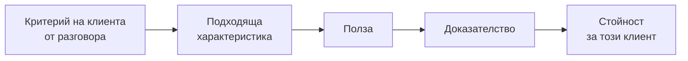

# Модул 07. От характеристика към полза и стойност

## Цели на урока

След този урок ученикът може да:

* разграничи характеристика, полза и стойност;
* избягва обещания, които не може да подкрепи с доказателство;
* свърже характеристика с потребност и критерий на конкретен клиент;
* формулира и представи 60-секундно стойностно предложение;
* добави към предложението нова гледна точка за клиента по модела Challenger.

## 1. Три нива на едно и също нещо

**Feature (характеристика)** е какво има продуктът. Факт, който може да се провери. „Батерията е 5000 mAh.“

**Benefit (полза)** е какво прави характеристиката за човека. „Телефонът издържа цял ден без зареждане.“

**Value (стойност)** е какво означава ползата за този конкретен клиент. „Не се притесняваш, че ще останеш без връзка на връщане от тренировка вечер.“

Характеристиката е еднаква за всички. Ползата е за повечето. Стойността е само за конкретния човек и затова изисква да знаеш нуждата му от модул 02 и 06.

### Формулата „има, помага, значи“

* **Има:** „Тази раница има отделно подплатено отделение.“
* **Помага:** „Помага лаптопът да не се удря.“
* **Значи за клиента:** „Значи можеш да я носиш в претъпкания автобус всяка сутрин, без да се притесняваш за лаптопа, за който си спестявал.“

> **Опитай сам.** Вземи три характеристики на своя телефон и ги прекарай през „има, помага, значи“ за себе си.

## 2. Неподкрепените обещания

**Claim (твърдение)** е всяко нещо, което казваме за продукта. Някои твърдения са проверими, други са празни или подвеждащи.

| Твърдение | Проблем | По-добре |
|---|---|---|
| „Най-добрият на пазара.“ | спрямо какво, кой го е измерил | „Има най-високата оценка в теста на списание X от октомври 2026.“ (ако е вярно) |
| „Никога няма да се развали.“ | невъзможно обещание | „Гаранцията е 2 години, а сервизът ни е в същия град.“ |
| „Всички го купуват.“ | неясно, натиск | „Това е вторият най-продаван модел в магазина този месец.“ |
| „100% натурален.“ | трябва доказателство | „Съставът е на етикета, ето сертификата за биологично производство.“ |

В България Законът за защита на потребителите забранява заблуждаващите търговски практики. Твърдения, които не можеш да докажеш, са не само неетични, но могат да доведат и до санкция за фирмата. Освен това един разочарован клиент пише ревю.

**Правилото:** всяка полза в предложението трябва да има поне едно доказателство, което можеш да покажеш.

**Proof (доказателство)** може да бъде: технически данни, гаранция, сертификат, отзив на реален клиент, демонстрация на място, тест от независим източник, пробен период.

> **Опитай сам.** Разбор на продуктови твърдения. Намери в eMAG или в сайта на голяма верига три описания на продукти. Подчертай твърденията. Кои са проверими и кои не? Преработи едно.

## 3. Свързване с конкретна потребност

Продавачът знае 20 характеристики на продукта. Клиентът иска да чуе 2 или 3. Изкуството е да избереш точните.

### Матрица характеристика, полза, доказателство, критерий

| Характеристика | Полза | Доказателство | Критерий на клиента |
|---|---|---|---|
| тегло 1,1 кг | лесно се носи | данни от производителя, вдигни го | „ще го нося всеки ден в училище“ |
| батерия до 14 ч | цял учебен ден | независим тест | „в класната няма контакти“ |
| 16 GB RAM | много програми наведнъж | демонстрация с отворени програми | „правя монтаж на видео“ |
| RGB клавиатура | красиво | вижда се | (няма такъв критерий) |

Последният ред е важен. RGB клавиатурата е характеристика, но клиентът не я е поискал. Ако времето ни е малко, я пропускаме. Повече аргументи не правят предложението по-силно, а по-шумно.

Обърни внимание на посоката. Започваме от критерия на клиента, не от продукта.

> **Опитай сам.** Попълни матрицата за абонамент за мобилен интернет за двама клиенти: ученичка, която гледа много видео, и пенсионер, който говори основно по телефона.

## 4. Стойностното предложение

**Value proposition (стойностно предложение)** е кратко и ясно обяснение защо точно това решение е подходящо за точно този клиент. В продажбения разговор то трае около минута.

Структура за 60 секунди:

1. **Какво разбрах:** „Казахте, че…“ (нуждата и критериите с думите на клиента).
2. **Какво предлагам:** едно решение, с име.
3. **Защо пасва:** две или три ползи, свързани с критериите.
4. **Доказателство:** по едно за всяка полза.
5. **Честно ограничение:** ако има такова.
6. **Следваща стъпка:** какво предлагаш да направите сега.

### Пример

„Казахте, че искате колело за града, с което да ходите на училище, и че нямате къде да го прибирате освен на балкона. Предлагам ви сгъваемото градско колело. Сгъва се за 15 секунди, ще ви покажа сега, и влиза в асансьора. Тежи 12 кг, можете да го вдигнете по стълбите. Няма скорости за стръмни баири, но по вашия маршрут, както го описахте, не са ви нужни. Искате ли да го пробвате на паркинга?“

Предложението се оценява по три критерия: **релевантност** (отговаря на нуждата), **яснота** (разбира се от първия път), **достоверност** (всяка полза има доказателство).

> **Опитай сам.** Подготви 60-секундно предложение за продукт или услуга по избор за клиент от задачите. Изнеси го пред партньор. Партньорът оценява по рубриката релевантност, яснота, достоверност и предлага една редакция.

## 5. Challenger: продавачът, който учи

През 2011 г. Матю Диксън и Брент Адамсън публикуват изследване на хиляди продавачи (книгата „The Challenger Sale“). Те разделят продавачите на пет типа и откриват, че в сложните продажби най-успешни са **Challengers (предизвикателите)**. Не най-приятните, не най-работливите, а тези, които **учат клиента на нещо ново за собствения му бизнес**.

Те правят три неща:

1. **Teach (учат).** Показват на клиента нещо, което той не е знаел: проблем, който не е забелязал, или възможност, която не е видял. „Знаете ли, че 30% от записаните часове в салоните се пропускат и повечето от тях могат да се спасят с напомняне по SMS?“
2. **Tailor (пригаждат).** Казват го на езика на конкретния човек: на собственика говорят за пари, на рецепционистката за по-малко обаждания.
3. **Take control (водят разговора).** Не се страхуват да кажат „Не съм съгласен, ето защо“ и спокойно говорят за пари и следващи стъпки.

Това не противоречи на слушането от модул 06. Първо разбираш нуждата, после носиш нова гледна точка. Стойностното предложение става по-силно, когато съдържа идея, до която клиентът не е стигнал сам.

**Внимание:** „учиш“ само с вярна информация и доказателства. Предизвикателството без доказателство е самонадеяност.

> **Опитай сам.** Избери малък бизнес около училището. Намери една вярна идея (число, тенденция, пример от друг бизнес), която собственикът вероятно не знае и която има връзка с твоята услуга. Напиши как ще я кажеш в две изречения.

## 6. Как го правят големите

### Пример от голяма компания: доверието като част от продукта

Anthropic продава Claude на големи компании. За тях една от най-важните ползи не е „колко е умен моделът“, а „какво става с данните ни“. Затова в стойностното предложение влизат характеристики като контрол върху данните, администриране и възможност Claude да се купи през облака, с който компанията вече работи (Amazon, Google или Microsoft), с една фактура и без нов доставчик.

Формулата „има, помага, значи“ тук звучи така: **има** достъп през вашия облак; **помага** да не минавате през нова процедура за доставчик; **значи** можете да започнете по-бързо и с по-малко риск за сигурността.

> **Опитай сам.** Напиши стойностно предложение от 60 секунди за Claude към училище. Не обещавай нищо, което не можеш да докажеш, и кажи едно честно ограничение.

## Въпроси за дискусия

1. Защо „най-добрият на пазара“ не убеждава?
2. Кога е добре да кажеш на клиента ограничението на продукта?
3. Какво губиш, ако изброиш всички характеристики?

## Ключови термини

| Термин | Превод |
|---|---|
| Feature | характеристика |
| Benefit | полза |
| Value | стойност |
| Claim | твърдение |
| Proof | доказателство |
| Value proposition | стойностно предложение |

| Challenger Sale | продажба, в която продавачът учи клиента |
| Teach, tailor, take control | учи, пригаждай, водѝ |