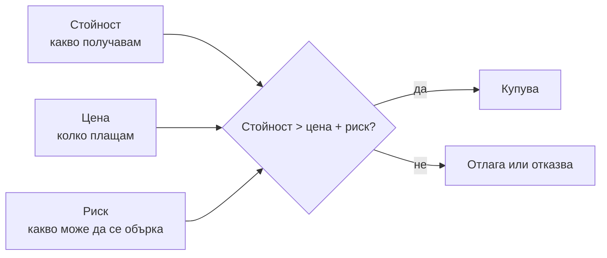

# Модул 08. Цена, отстъпка и основи на преговорите

| Час | Дата | Тема | Вид |
|---|---|---|---|
| 22 | 24.02.2027 | Цена, стойност и възприеман риск | Нови знания |
| 23 | 10.03.2027 | Обясняване на цена без автоматична отстъпка | Упражнение |
| 24 | 17.03.2027 | Подготовка и поведение при преговор | Практическа работа |

> **Задължителен източник за час 22.** Актуална фирмена оферта с условия и дата (от сайт или магазин) и официален източник за потребителското право: Комисията за защита на потребителите, [kzp.bg](https://kzp.bg), и Законът за защита на потребителите.

## Цели на урока

След този урок ученикът може да:

* обясни връзката между цена, стойност и възприеман риск;
* определи какво би намалило риска за клиента;
* аргументира цена чрез стойност и условия, без автоматична отстъпка;
* подготви преговор с цел, граница и алтернатива и да запише договореното.

## 1. Цена, стойност, риск

**Price (цена)** е сумата, която клиентът плаща.
**Value (стойност)** е това, което получава според себе си (модул 01 и 05).
**Perceived risk (възприеман риск)** е страхът, че покупката може да се окаже грешка.

Клиентът купува, когато вижда, че стойността е по-голяма от цената плюс риска.

Затова понякога продажбата става не с по-ниска цена, а с по-малък риск.

### Видове риск и как се намаляват

| Риск | Клиентът мисли | Какво намалява риска |
|---|---|---|
| финансов | „Ще дам пари за нищо.“ | ясна цена без скрити такси, разсрочено плащане, право на връщане |
| функционален | „Няма да работи както очаквам.“ | демонстрация, пробен период, гаранция |
| социален | „Какво ще кажат другите?“ | отзиви, препоръки |
| времеви | „Ще загубя време, ако не става.“ | бърза подмяна, сервиз наблизо |

### Какво казва законът

Някои неща, които намаляват риска, не са подарък от фирмата, а право на клиента. При покупка онлайн или извън търговския обект потребителят може да се откаже от договора в 14-дневен срок без да посочва причина, с някои изключения. За стоки има законова гаранция за несъответствие с договора. Продавачът не бива да представя законните права на клиента като специална отстъпка или бонус.

> **Опитай сам.** Казус с две ценови предложения от задачите. Направи карта на риска: за всяко предложение запиши какъв риск вижда клиентът и какво доказателство го намалява. Провери условията за връщане на сайта на реален магазин и запиши датата, на която си ги прочел.

## 2. Защо автоматичната отстъпка вреди

Продавач, който дава отстъпка при първото „скъпо е“, изпраща три послания:

1. цената не е била честна от самото начало;
2. който натиска, получава повече;
3. стойността на продукта е по-малка, отколкото казвахме.

**Discount (отстъпка)** не е забранена. Тя е инструмент, но трябва да има причина: по-голямо количество, плащане предварително, по-дълъг договор, изложбен продукт.

### Размяна, не подарък

Ако даваш нещо, получаваш нещо. Това се нарича **trade-off in negotiation (размяна при преговор)**.

| Вместо | Кажи |
|---|---|
| „Добре, ще ви направя 10%.“ | „Мога да сваля 10%, ако платите годината наведнъж.“ |
| „Ще ви дам доставката безплатно.“ | „Доставката е безплатна, ако поръчате до петък и вземем две бройки.“ |
| „Ще видя какво може да се направи.“ | „Цената е тази. Мога да добавя монтажа, ако подпишем днес.“ |

> **Опитай сам.** Преработи три ценови отговора: (1) „Е, добре, ще ви сваля 20 евро.“; (2) „Цената си е такава, не мога да направя нищо.“; (3) „Ако купите сега, ще ви сложа отстъпка, иначе не.“

## 3. Как да обясниш цената

1. **Свържи цената с потвърдената стойност.** „Казахте, че губите по 2 часа седмично. Системата ги спестява за 15 евро месечно.“
2. **Раздели я, ако помага.** „Годишната цена е 120 евро, по-малко от 35 цента на ден.“ Само ако е честно и уместно.
3. **Покажи какво включва.** Монтаж, гаранция, обучение, поддръжка.
4. **Сравни честно.** Ако по-евтиният вариант покрива нуждата, кажи го.

## 4. Основи на преговорите

**Negotiation (преговор)** е разговор, в който две страни с различни интереси търсят споразумение, което е по-добро и за двете от липсата на споразумение.

### Подготовка: цел, граница, алтернатива

* **Target (цел):** какво искам да постигна. „Да продам на 1 200 евро с монтаж.“
* **Walk-away point (граница):** под какво не приемам. „Под 1 050 евро без монтаж няма да продам.“
* **BATNA (най-добрата алтернатива, ако няма споразумение):** какво правя, ако не се разберем. „Имам друг клиент, който чака за същия продукт.“

Колкото по-добра е алтернативата ти, толкова по-спокойно преговаряш. Помисли и каква е алтернативата на другата страна.

### Интереси, не позиции

**Position (позиция)** е това, което някой казва, че иска: „Искам 15% отстъпка.“
**Interest (интерес)** е защо го иска: „Бюджетът ни за тази година е до 1 000 евро.“

Ако преговаряш по позиции, спориш за процент. Ако разбереш интереса, можеш да предложиш друго: плащане на две части в две години, по-малък пакет сега и разширение после.

### Записване на договореното

Накрая обобщаваш на глас и пишеш: какво, на каква цена, при какви условия, кой какво прави и до кога. Неписаното споразумение лесно се помни различно.

> **Опитай сам.** Симулация „Цена срещу условия“ от задачите. Попълни индивидуалния план преди преговора и общия протокол след него.

## Въпроси за дискусия

1. Защо понякога клиентът купува по-скъпия продукт?
2. Каква е разликата между отстъпка и размяна?
3. Защо е важно да знаеш алтернативата си преди преговора?

## Ключови термини

| Термин | Превод |
|---|---|
| Perceived risk | възприеман риск |
| Discount | отстъпка |
| Negotiation | преговор |
| Walk-away point | граница, под която не приемаш |
| BATNA | най-добрата алтернатива при липса на споразумение |
| Position / interest | позиция / интерес |

## Източници

* Закон за защита на потребителите.
* Комисия за защита на потребителите, [kzp.bg](https://kzp.bg).
* Fisher, R., Ury, W. Getting to Yes, за преговорите по интереси.
