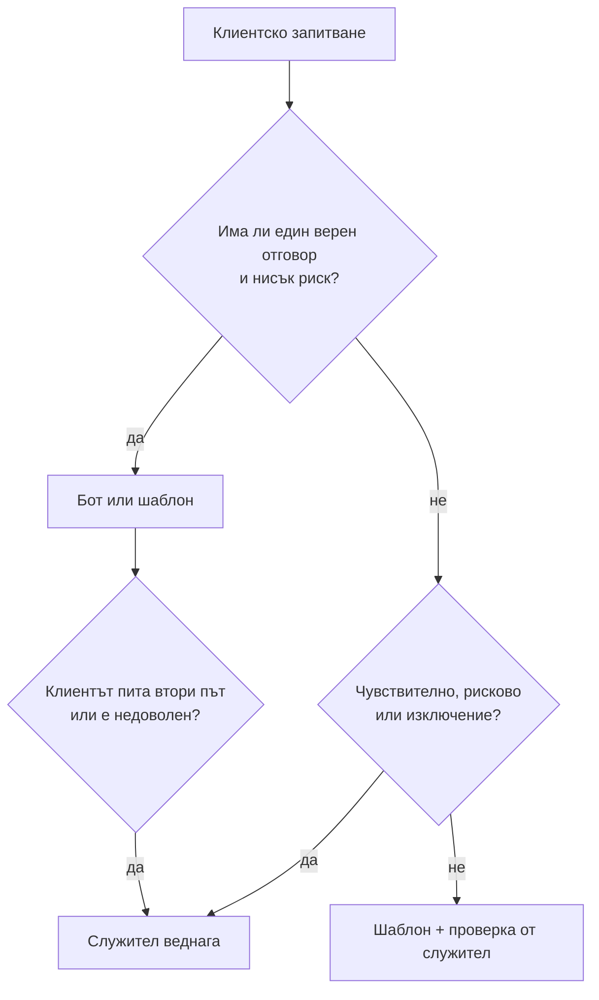

# Модул 09. Продажба в дигитална среда

| Час | Дата | Тема | Вид |
|---|---|---|---|
| 25 | 24.03.2027 | Канал и контекст: чат, имейл, социални мрежи, телефон, е-магазин | Нови знания |
| 26 | 31.03.2027 | Отговор на клиентско запитване | Упражнение |
| 27 | 14.04.2027 | Автоматизация или човешки контакт | Практическа работа |

> **Задължителен източник за час 26.** Зададените условия на търговеца (доставка, връщане, цени) и учебният клиентски казус от задачите. Отговорът се пише само по тях, без измислени условия.

## Цели на урока

След този урок ученикът може да:

* адаптира едно послание според канала;
* разпознае ограниченията и риска на всеки канал;
* напише кратък, ясен и полезен отговор на запитване, след като провери фактите;
* реши кога автоматизацията е подходяща и кога разговорът трябва да мине към човек.

## 1. Пет канала, едно послание

В модул 03 избирахме канал за разговор. Сега гледаме продажбата като цяло: голяма част от покупките днес започват или завършват онлайн. Клиентът вижда продукта в TikTok, пита в Instagram, поръчва от сайта и получава в автомат на Box Now.

Сравняваме каналите по четири критерия: **скорост**, **яснота**, **следа** (остава ли запис) и **човешки контакт**.

| Канал | Скорост | Яснота | Следа | Човешки контакт | Риск |
|---|---|---|---|---|---|
| Чат на сайта, Messenger, Viber | висока | средна | да | среден | бърз отговор без проверка |
| Имейл | ниска | висока | да | нисък | дълъг, безличен текст |
| Коментар или съобщение в социални мрежи | висока | ниска | публична | среден | лични данни в публичен коментар |
| Телефон | висока | средна | не | висок | няма запис на договореното |
| Е-магазин (продуктова страница) | моментна | зависи от текста | да | няма | клиентът не може да попита |

### Едно послание в пет версии

Магазин за велосипеди съобщава, че моделът, който клиентът е питал, е отново в наличност.

* **Чат:** „Здравейте, Петър! Моделът Urban 3 в размер M отново е наличен. Да ви го запазя ли до събота?“
* **Имейл:** със заглавие, поздрав, наличност, цена, срок за запазване, линк към продукта, подпис.
* **Социални мрежи:** в публичен коментар само „Писахме ви на лично 🙂“, детайлите в лично съобщение.
* **Телефон:** кратко, с въпрос, и после SMS или имейл с договореното.
* **Е-магазин:** бутон „Уведоми ме при наличност“ и автоматичен имейл.

> **Опитай сам.** Напиши едно и също съобщение в пет версии: „Поръчката ви ще закъснее с два дни заради празниците.“

## 2. Отговор на клиентско запитване

Добрият писмен отговор отговаря на въпроса още в първото изречение и казва какво следва.

### Чеклист преди изпращане

| Проверка | Въпрос |
|---|---|
| **Точност** | Цената, наличността, срокът и условията проверени ли са в системата, а не по памет? |
| **Тон** | Звучи ли уважително и спокойно, дори ако клиентът е ядосан? |
| **Поверителност** | Има ли лични данни, които не бива да се пишат тук (публичен коментар, чужд номер на поръчка)? |
| **Действие** | Ясно ли е какво следва и кой го прави? |

### Пример: преди и след

**Запитване:** „Здравейте, поръчах в понеделник, още нищо. Къде ми е пратката???“

**Преди:** „Здравейте, моля проверете в сайта на куриера.“

**След:** „Здравейте, Мария, разбирам, че чакате от понеделник. Проверих поръчката ви: изпратена е вчера с Еконт, номерът на товарителницата е в имейла от сряда. Пристига утре до офиса, който сте избрали. Ако утре до 18:00 няма известие, пишете ми тук и ще проверя лично.“

> **Опитай сам.** Редактирай три отговора от задачите по чеклиста. Отбележи коя проверка не е мината във всеки оригинал.

## 3. Автоматизация или човек

Много фирми ползват **chatbot (чатбот)**, шаблонни отговори и автоматични имейли. Те са полезни, но не винаги.

### Кога автоматизацията е подходяща

* често повтарящи се въпроси с един верен отговор (работно време, статус на пратка);
* потвърждения (поръчка, плащане, час);
* напомняния;
* събиране на основна информация, преди да се включи човек.

### Кога трябва да се ескалира към човек

**Escalation (ескалиране)** е прехвърлянето на разговора към служител.

* **риск:** става дума за пари, здраве, безопасност, правна последица;
* **неяснота:** ботът не разбира въпроса или клиентът пита за втори път;
* **чувствителност:** клиентът е разстроен, оплаква се, има личен проблем;
* **изключение:** ситуацията не е в правилата (повреден продукт, грешна доставка).

### Пример: грешка в автоматизиран отговор

Клиентка пише в чата на онлайн аптека: „Детето ми глътна две таблетки от лекарството ми, какво да правя?“ Ботът отговаря: „Благодарим за съобщението! Работното ни време е 9:00 до 18:00.“ Това е опасна грешка. Правилният дизайн разпознава думи за спешност и веднага дава телефон 112 и номер на спешна консултация, после прехвърля към човек.

> **Опитай сам.** Карта на решенията за магазин за обувки: за 8 типа запитвания реши бот, шаблон или служител. Обоснови по риск, неяснота и чувствителност.

## Въпроси за дискусия

1. Кое запитване никога не бива да остане само в ръцете на бот?
2. Защо публичен коментар не е мястото за номер на поръчка и адрес?
3. Как автоматизацията може да подобри, а не да развали, човешкия контакт?

## Ключови термини

| Термин | Превод |
|---|---|
| Inquiry | запитване |
| Chatbot | чатбот |
| Template | шаблон |
| Escalation | ескалиране, прехвърляне към човек |
| Response time | време за отговор |
| Omnichannel | обслужване през всички канали като едно цяло |
