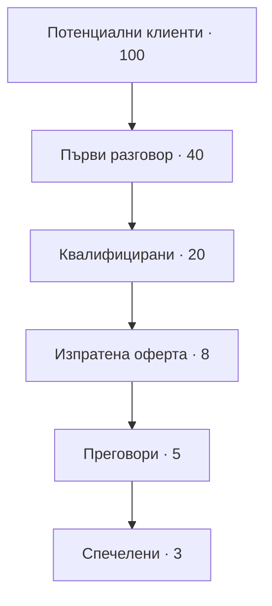

# Модул 09. Фунията на продажбите, метрики и CRM

## Цели на урока

След този урок ученикът може да:

* начертае фунията на продажбите и да обясни какво става на всеки етап;
* изчисли процент на превръщане, процент на спечелени сделки, средна сделка и продължителност на цикъла;
* изчисли претеглената стойност на сделките в процес;
* води сделки в CRM система и да направи кратък отчет.

## 1. Фунията на продажбите

Не всеки, с когото говориш, ще купи. Ако 100 души видят предложението ти, може би 20 ще проявят интерес, 8 ще поискат оферта и 3 ще купят. Тази картина се нарича **sales funnel (фуния на продажбите)**: широка отгоре, тясна отдолу.

Добрият продавач не гледа само дъното. Гледа къде се губят най-много хора и поправя точно този етап. Ако от 20 квалифицирани само 1 получава оферта, проблемът е в разговора, не в рекламата.

**Pipeline (поток от сделки в процес)** е списъкът с всички отворени сделки и етапа, на който е всяка. Фунията показва процента, pipeline показва конкретните сделки.

## 2. Метриките, които всеки продавач знае

| Метрика | Формула | Пример |
|---|---|---|
| **Conversion rate (процент на превръщане)** между два етапа | следващ етап ÷ предишен етап × 100 | 8 оферти от 20 квалифицирани = 40% |
| **Win rate (процент на спечелени сделки)** | спечелени ÷ всички затворени (спечелени + загубени) × 100 | 3 спечелени, 5 загубени = 37,5% |
| **Average deal size (средна сделка)** | общ приход ÷ брой спечелени сделки | 4 500 евро от 3 сделки = 1 500 евро |
| **Sales cycle (цикъл на продажбата)** | средно дни от първия контакт до сделката | 35 дни |
| **Weighted pipeline (претеглена стойност)** | сума от стойност × вероятност за всяка сделка | виж по-долу |
| **Target, quota (цел, норма)** | колко трябва да продадеш за период | 20 000 евро на тримесечие |

### Претеглена стойност

Сделка за 2 000 евро на етап „оферта“ не е 2 000 евро в джоба. Ако знаем от опит, че на този етап печелим 40% от сделките, тя „струва“ 800 евро.

| Сделка | Стойност | Етап | Вероятност | Претеглена |
|---|---|---|---|---|
| Хотел „Морско“ | 3 000 евро | преговори | 60% | 1 800 евро |
| Пекарна „Злато“ | 800 евро | оферта | 40% | 320 евро |
| Фитнес „Пулс“ | 1 500 евро | първи разговор | 10% | 150 евро |
| **Общо** | **5 300 евро** | | | **2 270 евро** |

Ако целта е 4 000 евро, продавачът вижда, че му трябват още сделки, макар сумата на всичко да е 5 300.

### Обратно смятане

Ако целта е 6 000 евро, средната сделка е 1 500 евро, процентът на спечелени е 30%, а от първи разговор до квалифициран стигат половината, колко първи разговора трябват?

* сделки: 6 000 ÷ 1 500 = 4;
* квалифицирани: 4 ÷ 0,30 ≈ 14;
* първи разговори: 14 ÷ 0,5 = 28.

Това е силата на числата: голямата цел става конкретен брой разговори.

> **Опитай сам.** Ученическа фирма продава снимки по 60 евро. Целта е 600 евро за месеца. От 10 първи разговора 4 искат оферта, а от 4 оферти 2 се превръщат в сделка. Колко първи разговора трябват?

## 3. CRM: къде живеят клиентите

**CRM, Customer Relationship Management (система за управление на взаимоотношенията с клиентите)** е мястото, където фирмата пази всички контакти, разговори, сделки и задачи. Ако продавачът се разболее или напусне, колегата отваря CRM и вижда всичко.

Какво има в една CRM:

* **контакти и фирми:** кой е клиентът, как се свързваме;
* **сделки:** стойност, етап, вероятност, очаквана дата;
* **дейности:** обаждания, имейли, срещи, бележки;
* **задачи:** какво трябва да направя и кога;
* **отчети:** фунията, целта, кой продавач как се справя.

Популярни CRM системи: **Salesforce** (най-голямата в света, за големи фирми), **HubSpot** (има безплатна версия, удобна за учене), **Pipedrive** (за малки екипи). Много български фирми ползват и местни решения или просто Google Sheets, когато започват.

### Пример от голяма компания: Salesforce и AI агентите

Salesforce продава CRM системи и през 2026 г. в нея работят AI агенти, които сами обработват голям брой потенциални клиенти: отговарят, квалифицират, насрочват срещи. По думите на главния изпълнителен директор Марк Бениоф продавачите на компанията продължават да са нужни за сключването на сделките. AI поема рутината, но само ако данните в CRM са верни. Грешни данни вътре, грешни решения навън.

### Правилата на добрия запис

1. Всеки разговор се записва в същия ден.
2. Всяка сделка има следваща стъпка с дата.
3. Етапът се сменя само когато има доказателство (например офертата е изпратена, не „ще я пратя“).
4. Не се записват ненужни лични данни (модул 14).

> **Опитай сам.** Създай безплатен акаунт в HubSpot CRM (по правилата на училището) или таблица в Google Sheets с колони: фирма, контакт, стойност, етап, вероятност, следваща стъпка, дата. Въведи 5 измислени сделки и изчисли претеглената стойност.

## 4. Числата не заменят човека

Метриките показват **къде** има проблем, но не **защо**. Ако процентът на спечелени пада, отговорът е в разговорите: слушаме ли достатъчно, правилни ли клиенти търсим, ясна ли е офертата. Затова добрият мениджър гледа числата и после слуша записи от разговори.

Внимание и към обратния ефект: продавач, когото гонят само за числото, лесно започва да натиска клиентите. Добрите компании мерят и удовлетвореността на клиентите и колко от тях се връщат.

## Въпроси за дискусия

1. Защо 5 300 евро в процес не значи 5 300 евро приход?
2. Какво бихте направили, ако фунията губи най-много хора между първия разговор и квалифицирането?
3. Какви са рисковете, ако продавачът се оценява само по брой продажби?

## Ключови термини

| Термин | Превод |
|---|---|
| Sales funnel | фуния на продажбите |
| Pipeline | поток от сделки в процес |
| Conversion rate | процент на превръщане |
| Win rate | процент на спечелени сделки |
| Average deal size | средна стойност на сделка |
| Sales cycle | цикъл на продажбата |
| Weighted pipeline | претеглена стойност на сделките в процес |
| Quota | норма, цел за продажби |
| CRM | система за управление на взаимоотношенията с клиентите |
