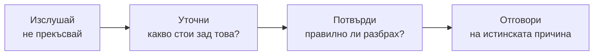
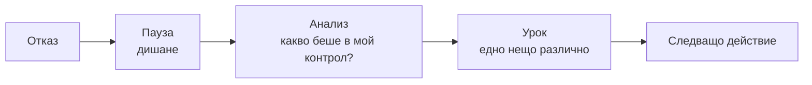

# Модул 10. Възражения, колебания и трудни ситуации

## Цели на урока

След този урок ученикът може да:

* разграничи въпрос, възражение, колебание и отказ;
* избере професионален отговор според вида на реакцията;
* уточни причината, преди да отговори;
* реагира спокойно на трите най-чести възражения и да договори етична следваща стъпка;
* използва техники за устойчивост след отказ.

## 1. Четири реакции, които звучат еднакво

Клиентът казва нещо, което не е „да“. Начинаещият продавач чува „не“ и или се отказва, или натиска. Опитният първо разбира какво точно е чул.

| Реакция | Какво е | Пример | Какво прави продавачът |
|---|---|---|---|
| **Question (въпрос)** | търси информация | „Има ли гаранция?“ | отговаря точно |
| **Objection (възражение)** | вижда конкретна пречка | „Твърде тежък е за мен.“ | уточнява и отговаря на пречката |
| **Hesitation (колебание)** | не е сигурен, без ясна причина | „Не знам… ще помисля.“ | помага да назове причината |
| **Refusal (отказ)** | решил е, че не иска | „Не, благодаря, не ми трябва.“ | приема с уважение |

Отказът е право на клиента. Продавач, който не приема „не“, вече не продава, а натиска. Добре приетият отказ често се превръща в продажба по-късно, защото клиентът си тръгва с добро чувство.

### Езикови доказателства

Как разбираме кое е? По думите.

* въпрос: въпросителна форма, търси факт („Колко време…?“, „Може ли…?“);
* възражение: назовава пречка („много“, „твърде“, „не ми пасва“, „нямам“);
* колебание: неопределени думи („не знам“, „може би“, „ще видим“);
* отказ: ясно решение („не“, „не ме интересува“, „благодаря, ще мина“).

> **Опитай сам.** Класифицирай: (1) „Ама това само в черно ли го има?“; (2) „Абонаментът ми е много за един човек.“; (3) „Хм, не съм сигурна дали ми трябва точно сега.“; (4) „Благодаря, но вече си купих.“ Подчертай думите, по които позна.

## 2. Причината зад възражението

Едно и също изречение може да има различни причини. „Скъпо е“ може да значи:

* наистина няма толкова пари;
* не вижда защо струва толкова (стойността не е ясна);
* сравнява с нещо по-евтино;
* иска да пробва дали ще получи отстъпка;
* трябва да пита някой друг, но не иска да го каже.

Ако отговориш, преди да разбереш, рискуваш да отговориш на грешния въпрос. Например даваш отстъпка на клиент, който всъщност не е разбрал защо продуктът е по-добър.

### Модел „изслушай, уточни, потвърди, отговори“

1. **Изслушай:** оставяш клиента да довърши, без да спориш.
2. **Уточни:** „Когато казвате скъпо, с какво го сравнявате?“
3. **Потвърди:** „Значи въпросът е дали си струва разликата от 40 евро спрямо другия модел, така ли?“
4. **Отговори:** само на потвърдената причина.

> **Опитай сам.** По двойки. Единият казва възражение, другият минава през четирите стъпки, без да прескача. Сменете ролите след три възражения.

## 3. Трите най-чести възражения

### „Скъпо е“

* **Не правиш:** веднага отстъпка; „Не е скъпо, другаде е по-скъпо.“
* **Правиш:** уточняваш с какво сравнява; връщаш се към ползите, които той е потвърдил; ако бюджетът наистина е по-малък, показваш вариант, който е в него.

„Разбирам. С какво го сравнявате? … Значи другият модел е с 30 евро по-евтин, но няма водоустойчивост, а вие казахте, че тичате и в дъжд. Струва ли си тази разлика за вас?“

### „Ще помисля“

Това често е учтив начин да се избегне истинската причина.

* **Не правиш:** „Помислете сега, после няма да има.“
* **Правиш:** „Разбира се. Да ви помогна ли да помислите? Кое ви кара да се колебаете най-много?“ Ако клиентът иска време, договаряш конкретна следваща стъпка: „Да ви пратя ли сравнението по имейл? Мога да ви се обадя в четвъртък, ако имате въпроси.“

### „Видях го по-евтино“

* **Не правиш:** „Сигурно е менте.“ (обиждаш избора му)
* **Правиш:** уточняваш къде и при какви условия; сравняваш честно (гаранция, доставка, сервиз, връщане); ако разликата е само в цената и няма какво друго да предложиш, го казваш.

„Може да е така. Къде го видяхте? … Там гаранцията е от вносителя, а при нас сервизът е в същия град и подмяната е до 3 дни. Ако това не е важно за вас, наистина е по-изгодно да го вземете оттам.“

## 4. Без натиск

**Pressure (натиск)** е всяко поведение, което кара клиента да реши, преди да е готов: изкуствена спешност, вина („аз ви отделих толкова време“), страх („ще съжалявате“), повтаряне на въпроса след ясен отказ.

Натискът може да донесе продажба днес. Но носи и върнати стоки, лоши ревюта и клиент, който не се връща. Освен това агресивните търговски практики са забранени от Закона за защита на потребителите.

**Етична следваща стъпка** е конкретна, приета доброволно и полезна за клиента: пробен период, изпратено сравнение, среща в определен ден, запазен продукт без задължение.

> **Опитай сам.** Ротационни симулации от задачите. Наблюдателят кодира всяка реплика на продавача: В (въпрос за уточняване), Д (доказателство), Н (натиск).

## 5. Устойчивост: как продавачът понася „не“

Продавачът чува „не“ много по-често от „да“. Ако процентът на спечелени е 25%, на всяка сделка идват три отказа (модул 09). Тези, които издържат в професията, не са тези, които не се разстройват, а тези, които знаят какво да правят с отказа.

**Resilience (устойчивост)** е способността да се възстановиш след неуспех и да продължиш. Спортните психолози работят с нея при състезателите, а същите техники работят и в продажбите:

1. **Отказът е за предложението, не за теб.** Клиентът казва „не“ на продукта, цената или момента, не на човека.
2. **Анализ, не самообвинение.** След всеки отказ три въпроса: Какво се случи? Какво беше в моя контрол? Какво ще направя различно следващия път?
3. **Цели за действие, не само за резултат.** Не „да продам 5 абонамента“, а „да проведа 20 разговора и във всеки да задам поне 3 въпроса за последици“. Действията са в твой контрол, резултатът не винаги.
4. **Рутина след неуспех.** Кратка пауза, дишане, една малка следваща задача. Състезателите имат рутина между два опита, продавачите между две обаждания.
5. **Отбелязвай напредъка.** Записвай не само сделките, но и подобренията: „днес клиентът сам ми каза проблема си“.

> **Опитай сам.** Спомни си последния път, когато някой ти е казал „не“ (на молба, предложение, покана). Мини през трите въпроса за анализ. Какво би направил различно?

## 6. Как го правят големите

### Пример от голяма компания: възраженията срещу AI

Когато голяма компания обмисля AI асистент като Claude или Agentforce, най-честите възражения са:

| Възражение | Причина зад него | Как се отговаря |
|---|---|---|
| „Скъпо е.“ | не вижда как ще се върнат парите | пилотен проект с измерим резултат |
| „Ще помислим.“ | страх за данните | среща с отдела за сигурност, документи за защита на данните |
| „Ние вече имаме решение.“ | никой не иска да сменя навиците си | показваш как се вгражда в това, което вече ползват |
| „Ще ни вземе работата.“ | страх на служителите | показваш задачите, които AI поема, и времето, което освобождава |

Salesforce например предлага неограничени договори за 2 до 3 години, защото клиентите възразяват срещу непредвидимите разходи при плащане според използването.

> **Опитай сам.** Изиграйте по двойки възражението „Ще ни вземе работата“ по модела изслушай, уточни, потвърди, отговори.

## Въпроси за дискусия

1. Защо „ще помисля“ рядко е истинската причина?
2. Кога е правилно да кажеш на клиента, че другаде е по-изгодно?
3. Как различаваш убеждаване от натиск?

## Ключови термини

| Термин | Превод |
|---|---|
| Objection | възражение |
| Hesitation | колебание |
| Refusal | отказ |
| Objection handling | работа с възражения |
| Pressure selling | продажба с натиск |
| Next step | следваща стъпка |

| Resilience | устойчивост, способност за възстановяване |