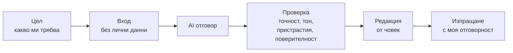

# Модул 11. Етика, клиентски данни и AI в продажбите

| Час | Дата | Тема | Вид |
|---|---|---|---|
| 30 | 05.05.2027 | Влияние, убеждаване и манипулация; лични данни | Нови знания |
| 31 | 12.05.2027 | AI като помощник с човешка проверка | Практическа работа |

> **Задължителни източници.** Училищната политика за използване на изкуствен интелект; официалният текст на Регламент (ЕС) 2016/679 (GDPR) на [eur-lex.europa.eu](https://eur-lex.europa.eu/legal-content/BG/TXT/?uri=CELEX:32016R0679); за час 31 учебният казус от задачите, без реални клиентски данни.

## Цели на урока

След този урок ученикът може да:

* разграничи етично влияние от манипулация;
* ограничи клиентските данни до необходимото и допустимото;
* използва AI за подготовка, а не за сляпо решение;
* провери AI отговор за точност, тон, пристрастия и поверителност.

## 1. Влияние, убеждаване, манипулация

Всяка продажба влияе на решението на клиента. Въпросът е как.

**Persuasion (убеждаване)** е влияние чрез вярна информация и аргументи, които клиентът може да провери. Той решава свободно.

**Manipulation (манипулация)** е влияние чрез скриване, изкривяване или натиск върху слабост: страх, срам, бързане, объркване. Клиентът решава нещо, което не би решил, ако знаеше всичко.

| Етично влияние | Манипулация |
|---|---|
| „Остават 3 бройки в склада.“ (вярно) | „Остават 3 бройки!“, когато има 300 |
| „Промоцията е до неделя.“ (вярно) | брояч, който се рестартира при всяко отваряне на страницата |
| реални отзиви, и добри, и лоши | измислени отзиви |
| ясна крайна цена | такси, които се появяват на последната стъпка |
| „Помислете спокойно.“ | „Всички в класа ти вече го имат.“ на 14-годишен |

**Dark patterns (тъмни модели)** са дизайнерски трикове в сайтове и приложения, които карат хората да правят неща против интереса си: абонамент, който е лесен за пускане и почти невъзможен за спиране; предварително отметнати кутийки; бутон „Не, не искам да спестя пари“.

Европейското и българското потребителско право забраняват заблуждаващите и агресивните търговски практики.

### Етичен съд

Упражнение: класът е съд. Всяка търговска реплика е „подсъдим“. Прокурорът казва защо е манипулация, защитата защо е етично убеждаване, съдиите решават по три въпроса: вярно ли е; може ли клиентът да го провери; решава ли свободно?

> **Опитай сам.** Намери в сайт или приложение един тъмен модел (отказ от абонамент, бисквитки, таймер). Направи снимка на екрана, без лични данни, и обясни какво е подвеждащото.

## 2. Клиентски данни

**Personal data (лични данни)** е всяка информация, по която може да се разпознае човек: име, телефон, имейл, адрес, номер на поръчка, IP адрес, снимка.

GDPR (Регламент (ЕС) 2016/679) задава принципи. Три от тях са най-важни за продавача:

1. **Purpose limitation (ограничение на целта):** събираш данни за ясна цел и не ги ползваш за друга без основание.
2. **Data minimisation (свеждане до минимум):** събираш само това, което ти трябва за целта.
3. **Security and confidentiality (сигурност и поверителност):** пазиш ги, не ги пращаш където не трябва.

Клиентът има права: да знае какви данни имаш за него, да ги поправи, в определени случаи да поиска изтриване, да се откаже от директен маркетинг.

### Казус с прекомерни данни

Магазин за обувки иска при регистрация за карта за отстъпки: име, имейл, телефон, ЕГН, адрес, месечен доход, семейно положение, снимка. Кое от това е нужно за карта за отстъпки? Имейл или телефон, евентуално име. Останалото не е нужно за целта.

| Данни | Нужни за картата? | Защо |
|---|---|---|
| имейл или телефон | да | за връзка и идентифициране |
| име | по избор | за обръщение |
| ЕГН | не | няма връзка с целта, висок риск |
| доход, семейно положение | не | няма връзка с целта |
| снимка | не | няма връзка с целта |

> **Опитай сам.** Редактирай формуляра за регистрация на магазина: остави само нужните полета и напиши едно изречение защо всяко е нужно.

## 3. AI като помощник

AI инструментите (ChatGPT, Gemini, Claude, Copilot) могат да помогнат на продавача: да подготви въпроси, да предложи структура на имейл, да обобщи продуктови данни, да даде идеи за възражения.

Но AI може да сгреши уверено, да измисли условия, да звучи безлично или да повтори пристрастие. И ако му дадеш лични данни на клиент, ги изпращаш на трета страна.

### Протокол: цел, вход без лични данни, проверка, редакция

1. **Цел:** „Трябва ми учтив имейл, който обяснява 14-дневния срок за връщане.“
2. **Вход без лични данни:** вместо „Мария Петрова от ул. Шипка 5 с поръчка 88231“ пишеш „клиентка, поръчка от сайта“.
3. **Проверка:**
   * **точност:** условията, цените и сроковете съвпадат ли с реалните на фирмата?
   * **тон:** звучи ли като човек от нашата фирма?
   * **пристрастия:** има ли предположения за клиента по пол, възраст, произход?
   * **поверителност:** има ли нещо, което не бива да излиза?
4. **Редакция:** човекът поправя и носи отговорност за изпратеното.

Когато фирма ползва чатбот, клиентът трябва да знае, че говори с AI. Това изисква и европейският Акт за изкуствения интелект.

> **Опитай сам.** Сравнение от задачите: един човешки и един AI отговор на едно и също запитване. Мини AI отговора през четирите проверки и го редактирай. Използвай AI само по правилата на училищната политика.

## Въпроси за дискусия

1. Къде минава границата между добра реклама и манипулация?
2. Защо „може да ни потрябва някой ден“ не е основание да събираме данни?
3. Ако AI сгреши в имейл до клиент, кой е отговорен?

## Ключови термини

| Термин | Превод |
|---|---|
| Persuasion | убеждаване |
| Manipulation | манипулация |
| Dark patterns | тъмни модели, подвеждащ дизайн |
| Personal data | лични данни |
| Data minimisation | свеждане на данните до минимум |
| Bias | пристрастие |
| Human in the loop | човешка проверка |

## Източници

* Регламент (ЕС) 2016/679 (Общ регламент относно защитата на данните).
* Закон за защита на потребителите.
* Регламент (ЕС) 2024/1689 (Акт за изкуствения интелект).
* Училищната политика за използване на изкуствен интелект.
