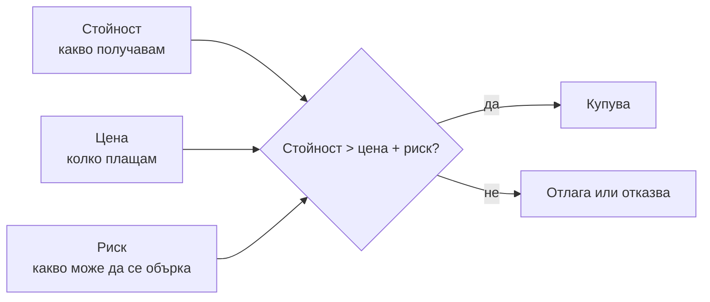
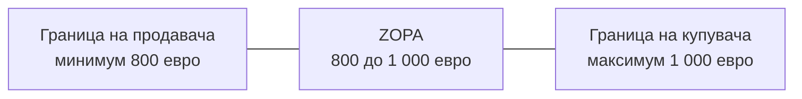
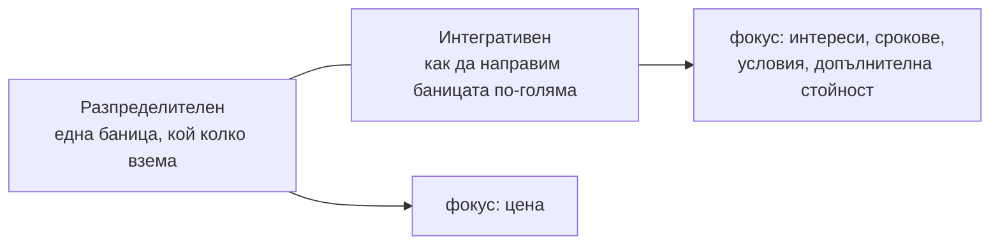

# Модул 11. Цена, отстъпка и основи на преговорите

> **Задължителен източник.** Актуална фирмена оферта с условия и дата (от сайт или магазин) и официален източник за потребителското право: Комисията за защита на потребителите, [kzp.bg](https://kzp.bg), и Законът за защита на потребителите.

## Цели на урока

След този урок ученикът може да:

* обясни връзката между цена, стойност и възприеман риск;
* определи какво би намалило риска за клиента;
* аргументира цена чрез стойност и условия, без автоматична отстъпка;
* подготви преговор с цел, граница и алтернатива и да запише договореното;
* разграничи едностранни, двустранни и многостранни (включително четиристранни) преговори и да се подготви за всеки вид;
* определи ZOPA и използва обоснована котва в преговор.

## 1. Цена, стойност, риск

**Price (цена)** е сумата, която клиентът плаща.
**Value (стойност)** е това, което получава според себе си (модул 01 и 07).
**Perceived risk (възприеман риск)** е страхът, че покупката може да се окаже грешка.

Клиентът купува, когато вижда, че стойността е по-голяма от цената плюс риска.

Затова понякога продажбата става не с по-ниска цена, а с по-малък риск.

### Видове риск и как се намаляват

| Риск | Клиентът мисли | Какво намалява риска |
|---|---|---|
| финансов | „Ще дам пари за нищо.“ | ясна цена без скрити такси, разсрочено плащане, право на връщане |
| функционален | „Няма да работи както очаквам.“ | демонстрация, пробен период, гаранция |
| социален | „Какво ще кажат другите?“ | отзиви, препоръки |
| времеви | „Ще загубя време, ако не става.“ | бърза подмяна, сервиз наблизо |

### Какво казва законът

Някои неща, които намаляват риска, не са подарък от фирмата, а право на клиента. При покупка онлайн или извън търговския обект потребителят може да се откаже от договора в 14-дневен срок без да посочва причина, с някои изключения. За стоки има законова гаранция за несъответствие с договора. Продавачът не бива да представя законните права на клиента като специална отстъпка или бонус.

> **Опитай сам.** Казус с две ценови предложения от задачите. Направи карта на риска: за всяко предложение запиши какъв риск вижда клиентът и какво доказателство го намалява. Провери условията за връщане на сайта на реален магазин и запиши датата, на която си ги прочел.

## 2. Защо автоматичната отстъпка вреди

Продавач, който дава отстъпка при първото „скъпо е“, изпраща три послания:

1. цената не е била честна от самото начало;
2. който натиска, получава повече;
3. стойността на продукта е по-малка, отколкото казвахме.

**Discount (отстъпка)** не е забранена. Тя е инструмент, но трябва да има причина: по-голямо количество, плащане предварително, по-дълъг договор, изложбен продукт.

### Размяна, не подарък

Ако даваш нещо, получаваш нещо. Това се нарича **trade-off in negotiation (размяна при преговор)**.

| Вместо | Кажи |
|---|---|
| „Добре, ще ви направя 10%.“ | „Мога да сваля 10%, ако платите годината наведнъж.“ |
| „Ще ви дам доставката безплатно.“ | „Доставката е безплатна, ако поръчате до петък и вземем две бройки.“ |
| „Ще видя какво може да се направи.“ | „Цената е тази. Мога да добавя монтажа, ако подпишем днес.“ |

> **Опитай сам.** Преработи три ценови отговора: (1) „Е, добре, ще ви сваля 20 евро.“; (2) „Цената си е такава, не мога да направя нищо.“; (3) „Ако купите сега, ще ви сложа отстъпка, иначе не.“

## 3. Как да обясниш цената

1. **Свържи цената с потвърдената стойност.** „Казахте, че губите по 2 часа седмично. Системата ги спестява за 15 евро месечно.“
2. **Раздели я, ако помага.** „Годишната цена е 120 евро, по-малко от 35 цента на ден.“ Само ако е честно и уместно.
3. **Покажи какво включва.** Монтаж, гаранция, обучение, поддръжка.
4. **Сравни честно.** Ако по-евтиният вариант покрива нуждата, кажи го.

## 4. Основи на преговорите

**Negotiation (преговор)** е разговор, в който две страни с различни интереси търсят споразумение, което е по-добро и за двете от липсата на споразумение.

### Подготовка: цел, граница, алтернатива

* **Target (цел):** какво искам да постигна. „Да продам на 1 200 евро с монтаж.“
* **Walk-away point (граница):** под какво не приемам. „Под 1 050 евро без монтаж няма да продам.“
* **BATNA (най-добрата алтернатива, ако няма споразумение):** какво правя, ако не се разберем. „Имам друг клиент, който чака за същия продукт.“

Колкото по-добра е алтернативата ти, толкова по-спокойно преговаряш. Помисли и каква е алтернативата на другата страна.

### Интереси, не позиции

**Position (позиция)** е това, което някой казва, че иска: „Искам 15% отстъпка.“
**Interest (интерес)** е защо го иска: „Бюджетът ни за тази година е до 1 000 евро.“

Ако преговаряш по позиции, спориш за процент. Ако разбереш интереса, можеш да предложиш друго: плащане на две части в две години, по-малък пакет сега и разширение после.

### Записване на договореното

Накрая обобщаваш на глас и пишеш: какво, на каква цена, при какви условия, кой какво прави и до кога. Неписаното споразумение лесно се помни различно.

> **Опитай сам.** Симулация „Цена срещу условия“ от задачите. Попълни индивидуалния план преди преговора и общия протокол след него.

## 5. ZOPA и котвата в преговорите

### Зоната на възможно споразумение

Всяка страна има граница (част 4 от този урок). Продавачът има минимална цена, под която не продава. Купувачът има максимална цена, над която не купува. Ако двете граници се застъпват, има **ZOPA, Zone of Possible Agreement (зона на възможно споразумение)**.

* Ако продавачът иска поне 800, а купувачът може да даде до 1 000, ZOPA е от 800 до 1 000. Сделката е възможна, въпросът е къде в зоната ще се договорят.
* Ако продавачът иска поне 1 200, а купувачът най-много 1 000, ZOPA няма. Тогава или се променя нещо друго (обхват, срок, условия), или е честно да се разделите.

Никоя страна не знае границата на другата. Затова въпросите за интересите и бюджета са толкова важни.

### Котвата: кой казва първото число

От модул 03 знаем, че първото число става отправна точка. В преговорите това важи още по-силно. Изследванията показват, че първата оферта често влияе силно на крайния резултат.

* **Кажи първото число, когато** знаеш добре пазара и стойността. Постави амбициозна, но обоснована котва и обясни защо.
* **Остави другия да започне, когато** не знаеш пазара; така научаваш нещо за неговата граница.
* **Ако другият постави нереалистична котва,** не спори с числото, а върни разговора към критериите: „Как стигнахте до тази сума? Нека погледнем какво включва.“

Етичната граница: котвата трябва да е обоснована. Измислена „пазарна цена“ е лъжа, не тактика.

> **Опитай сам.** Продаваш стария си телефон. Провери в OLX цените на същия модел. Определи граница, котва и обосновка за котвата. Изиграйте преговора по двойки, после разкрийте границите си. Имаше ли ZOPA? Къде се договорихте спрямо нея?

## 6. Видове преговори според броя на страните

Досега говорихме за преговор между продавач и клиент. В реалния бизнес страните може да са една, която диктува, две или много.

| Вид | Кой определя условията | Какво можеш да направиш | Пример |
|---|---|---|---|
| **Едностранни** | едната страна задава условията, другата приема или отказва | сравняваш алтернативи, питаш за изключение, използваш правата си | фиксираната цена на Tesla; общите условия на мобилен оператор; правилата на App Store |
| **Двустранни** | двете страни договарят заедно | търсиш интересите и размени | продавач и клиент; Nike и верига магазини |
| **Многостранни (три, четири и повече страни)** | всички страни, често с посредник | съюзи, общ дневен ред, протокол | сделката Microsoft и Activision с регулаторите и Ubisoft; абитуриентски бал |

### Едностранни: когато не можеш да преговаряш, а само да избереш

При **едностранно определени условия** едната страна е написала правилата предварително. Мобилните оператори, банките, онлайн магазините и приложенията работят с **общи условия**: ти ги приемаш с отметка или не ползваш услугата. Tesla продава колите си на една и съща цена за всички, без пазарлък.

Изглежда, че нямаш никаква сила. Но имаш:

* **алтернатива:** друг оператор, друга марка, да не купиш;
* **въпрос за изключение:** голям клиент често получава индивидуални условия;
* **закона:** Законът за защита на потребителите обявява за недействителни неравноправните клаузи в договорите с потребители, тоест условия, които са във вреда на потребителя и създават неравновесие между правата на двете страни;
* **гласа си:** отзив, жалба до Комисията за защита на потребителите.

От страна на продавача едностранните условия носят прозрачност: никой не плаща повече от съседа си. Цената е, че губиш гъвкавост.

### Двустранни: разпределяне или разширяване

Има два стила двустранен преговор.

**Distributive negotiation (разпределителен преговор):** има една „баница“ и всеки иска по-голямо парче. Каквото вземе единият, губи другият. Пример: пазарлък за цената на употребявана кола.

**Integrative negotiation (интегративен преговор):** страните търсят как да направят баницата по-голяма. Говорят за интереси, не само за цена. Пример: Salesforce предлага на големи клиенти неограничено ползване на AI агенти за 2 до 3 години, защото клиентите искат предвидим бюджет. Клиентът получава сигурност, Salesforce получава дълъг договор.

### Многостранни: четири страни на масата

Когато страните са три, четири и повече, преговорът става по-сложен:

* всяка страна има свои интереси, които могат да не се виждат;
* образуват се **съюзи** (коалиции): две страни се договарят помежду си срещу трета;
* нужен е **общ дневен ред**: за какво говорим и в какъв ред;
* често помага **посредник** (медиатор), който води разговора;
* договореното се записва в **протокол**, който всички потвърждават.

### Пример от голяма компания: Microsoft, Activision, регулаторите и Ubisoft

През 2022 г. Microsoft иска да купи Activision Blizzard за 68,7 млрд. долара. Сделката трябва да мине през регулаторите в САЩ, ЕС и Обединеното кралство. Британският орган за конкуренция блокира сделката през април 2023 г., защото се притеснява, че Microsoft ще контролира облачните игри. Microsoft не сваля цената, а преструктурира сделката: правата за облачно стрийминг на игрите извън Европейското икономическо пространство за 15 години отиват при четвърта страна, Ubisoft. През октомври 2023 г. регулаторът одобрява сделката.

Урокът: в многостранния преговор понякога решението е да добавиш нова страна, която поема част от проблема.

### Пример от голяма компания: Anthropic, Google и Broadcom

През април 2026 г. Anthropic обявява споразумение с Google и Broadcom за изчислителна мощност: Broadcom произвежда чиповете, Google ги предоставя в облака си, Anthropic ги използва за Claude. Три страни, всяка с различен интерес: Anthropic иска мощност, Google иска голям клиент за облака си, Broadcom иска поръчка за чипове.

### Как се подготвя четиристранен преговор

| Стъпка | Какво правиш |
|---|---|
| 1. Карта на страните | кой участва, кой решава, кой влияе отстрани |
| 2. Интереси | за всяка страна: какво иска и защо |
| 3. Алтернативи | какво прави всяка страна, ако няма споразумение |
| 4. Общи и спорни точки | къде интересите съвпадат и къде се сблъскват |
| 5. Възможни съюзи | кои страни имат общ интерес |
| 6. Дневен ред и посредник | в какъв ред говорим, кой води |
| 7. Протокол | кой какво прави, срещу какво, до кога |

> **Опитай сам.** Четиристранна симулация „Абитуриентски бал“ от задачите: училище, родителски комитет, ресторант и фотограф. Всяка група получава карта с тайни интереси. Целта е общ протокол, подписан от четирите страни.

## Въпроси за дискусия

1. Защо понякога клиентът купува по-скъпия продукт?
2. Каква е разликата между отстъпка и размяна?
3. Защо е важно да знаеш алтернативата си преди преговора?

## Ключови термини

| Термин | Превод |
|---|---|
| Perceived risk | възприеман риск |
| Discount | отстъпка |
| Negotiation | преговор |
| Walk-away point | граница, под която не приемаш |
| BATNA | най-добрата алтернатива при липса на споразумение |
| Position / interest | позиция / интерес |
| Distributive / integrative negotiation | разпределителен / интегративен преговор |
| Multi-party negotiation | многостранен преговор |
| Coalition | съюз, коалиция |
| Mediator | посредник, медиатор |
| Standard terms | общи условия |
| ZOPA | зона на възможно споразумение |
| Anchor | котва, първото число в преговора |

## Източници

* Закон за защита на потребителите.
* Комисия за защита на потребителите, [kzp.bg](https://kzp.bg).
* Fisher, R., Ury, W. Getting to Yes, за преговорите по интереси.
