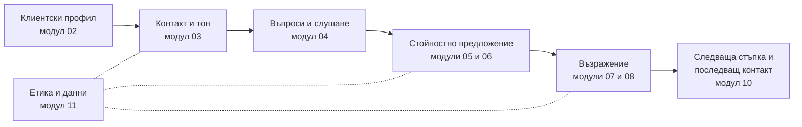

# Модул 12. Интегрирана продажбена симулация

## Цели на урока

След този модул ученикът може да:

* планира цялостен продажбен разговор в непозната ситуация;
* приложи последователно етапите на продажбата, професионално и без манипулация;
* договори конкретна следваща стъпка;
* направи самооценка с доказателства и план за подобрение.

## 1. Какво събираме

Тук няма нова теория. Събираме всичко от годината в един разговор.

## 2. подготовка

Всеки екип получава сценарий (в задачите). Сценарият е непознат: учениците не знаят всичко за клиента, както е в реалността.

### Екипен бриф

Екипът от трима попълва заедно:

* какво знаем за клиента и какво предполагаме;
* какви критерии вероятно има;
* какво решение бихме препоръчали и при какви условия;
* какви възражения очакваме;
* какво не бива да правим (етични граници);
* кой каква роля има в симулацията.

### Индивидуална карта

Всеки ученик попълва и своя карта, защото оценката е индивидуална:

| Хипотези за клиента | Въпроси, които ги проверяват | Стойност, която мога да предложа | Рискове и възражения | Моя отговор |
|---|---|---|---|---|
| | | | | |

> **Опитай сам.** Подготви поне 3 хипотези и по един въпрос за всяка. Кой въпрос ще зададеш пръв и защо?

## 3. разговорът

Ротационна симулация: клиент, продавач, наблюдател. Всеки разговор е 8 до 10 минути. Всеки ученик е продавач поне веднъж.

**Клиентът** има карта с неща, които продавачът не знае: истински бюджет, скрита причина за колебание, един критерий, който казва само ако бъде попитан.

**Наблюдателят** попълва рубриката с наблюдаеми индикатори. Не оценява „впечатлението“, а записва конкретни думи и действия.

### Рубрика с наблюдаеми индикатори

| Етап | 2 т. | 1 т. | 0 т. |
|---|---|---|---|
| Контакт | поздрав, внимание, професионален тон през целия разговор | тонът се променя | няма поздрав или е неуважителен |
| Диагностика | поне 3 отворени въпроса и откриване на скрития критерий | въпроси, но критерият остава неоткрит | преминава направо към предложение |
| Слушане | перифразира и обобщава с въпрос за потвърждение | обобщава без потвърждение | не обобщава |
| Предложение | свързано с поне 2 казани критерия, с доказателства | свързано с 1 критерий | изброява характеристики |
| Възражение | уточнява причината, преди да отговори, без натиск | отговаря, без да уточни | спори, натиска или дава автоматична отстъпка |
| Етика | вярна информация, казва ограничение, не пита за ненужни данни | няма нарушение, но не казва ограничение | подвеждащо твърдение или натиск |
| Следваща стъпка | конкретна, с дата и приета доброволно | неясна („ще се чуем“) | няма или е наложена |

Максимум: 14 точки.

## 4. обратна връзка и самооценка

### Обратна връзка

Наблюдателят дава обратна връзка по модела **видях, ефект, предложение**:

* **Видях:** „Когато клиентът каза „скъпо е“, ти веднага каза „ще ви сваля 10%“.“
* **Ефект:** „Не разбра, че всъщност сравнява с модел без гаранция.“
* **Предложение:** „Следващия път попитай с какво го сравнява.“

### Повторен опит

Продавачът повтаря само частта, в която е имал най-малко точки, с нов клиент.

### Портфолио: доказателство, извод, следващо действие

| Доказателство (какво се случи, с думи от разговора) | Извод (какво научих за себе си) | Следващо действие (какво ще направя различно) |
|---|---|---|
| | | |
| | | |
| | | |

Добрата самооценка не е „справих се добре“, а „в първия опит не открих скрития критерий, защото задавах само затворени въпроси; във втория зададох три отворени и клиентът сам каза, че му трябва до петък“.

## 5. Как го правят големите

### Пример от голяма компания: сценарий за напреднали

**Сценарий Г: AI асистент за верига аптеки.** Продавачът представлява компания, която продава AI асистент, изграден върху Claude, достъпен през облака, с който клиентът вече работи. Клиентът е верига от 40 аптеки. От страна на клиента участват четирима: управителят (иска по-кратки опашки), ИТ директорът (иска сигурност), юристката (иска защита на личните и здравните данни) и главният фармацевт (не иска AI да дава медицински съвети).

Това е многостранна продажба: продавачът трябва да разбере интересите на четирима души, да отговори на различни възражения и да договори пилотен проект в 3 аптеки с измерим резултат. Използвай [Как продават големите](#/golemite) за идеи.

## Въпроси за дискусия

1. Кой етап беше най-труден в симулацията и защо?
2. Какво те изненада, когато беше в ролята на клиент?
3. Какво ще използваш от този курс и извън продажбите?

## Ключови термини

| Термин | Превод |
|---|---|
| Role play | ролева игра, симулация |
| Brief | бриф, кратко задание |
| Observable indicator | наблюдаем индикатор |
| Self-assessment | самооценка |
| Portfolio | портфолио |
