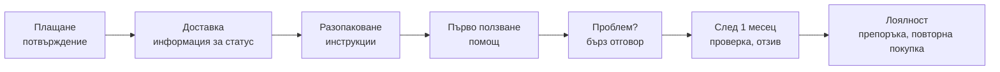

# Модул 13. След продажбата: обслужване, лоялност и допълнителна стойност

## Цели на урока

След този урок ученикът може да:

* обясни ролята на обслужването след покупката;
* предложи полезен последващ контакт;
* разграничи полезно от ненужно допълнително предложение;
* аргументира следващо действие със стойност за клиента и да направи план за възстановяване на доверие.

## 1. Продажбата не свършва с плащането

За клиента покупката продължава: доставка, разопаковане, първо ползване, първият проблем. Ако в тези моменти фирмата изчезне, той помни точно това.

Да спечелиш нов клиент обикновено струва много повече, отколкото да задържиш стар. Затова опитните продавачи гледат на първата покупка като на начало.

**After-sales service (следпродажбено обслужване)** е всичко, което фирмата прави за клиента след покупката: доставка, инструкции, поддръжка, гаранция, отговор на оплаквания.

### Карта на следпродажбеното преживяване

| Момент | Какво очаква клиентът | Полезен контакт |
|---|---|---|
| след плащане | сигурност, че поръчката е приета | потвърждение с номер и срок |
| доставка | да знае кога | известие при изпращане |
| първо ползване | да успее | кратко видео или инструкция |
| след месец | да е доволен | „Как се справяте? Нужда от помощ?“ |

**Полезен** означава, че клиентът печели от контакта. Пет рекламни имейла седмично не са последващ контакт, а шум.

> **Опитай сам.** Начертай картата за последната си онлайн покупка. В кой момент фирмата беше до теб и в кой изчезна?

## 2. Казус: забавена доставка

Онлайн книжарница обещава доставка за 2 дни. Поръчката на учителка, която подготвя подаръци за абитуриенти, закъснява с 5 дни заради грешка в склада. Тя пише гневен имейл.

**План за възстановяване на доверие** (service recovery):

1. **Признай** без оправдания: „Права сте, обещахме 2 дни, а сгрешихме ние.“
2. **Поеми отговорност** с конкретно действие: „Изпращаме я днес с експресна доставка за наша сметка.“
3. **Компенсирай разумно,** според загубата: отстъпка за следващата поръчка, безплатна доставка.
4. **Провери** след доставката: „Пристигна ли всичко наред?“
5. **Поправи причината** вътре във фирмата, за да не се повтори.

Клиент, чийто проблем е решен бързо и честно, често става по-лоялен, отколкото ако нямаше проблем.

> **Опитай сам.** Напиши отговора на книжарницата до учителката по петте стъпки.

## 3. Допродажба и кръстосана продажба

**Upselling (допродажба)** е предложение за по-добра или по-голяма версия: по-голям пакет, по-мощен модел.

**Cross-selling (кръстосана продажба)** е предложение за допълващ продукт: калъф към телефона, батерии към играчката, застраховка към пътуването.

И двете могат да са полезни или досадни. Разликата е в това дали служат на нуждата на клиента.

| Полезно | Ненужно |
|---|---|
| протектор за екран към телефон, който клиентът ще носи в джоба с ключове | разширена гаранция за 3 евро калъф |
| по-голям пакет данни, защото клиентът каза, че гледа видео в автобуса | премиум пакет с ТВ канали на човек, който каза, че не гледа телевизия |
| батерии към играчка, която ги изисква и не ги включва | пета чанта към покупката, „защото е на промоция“ |

### Етичният тест

Преди да предложиш нещо допълнително, задай си въпроса:

**„Бих ли го препоръчал и ако нямах цел за оборот?“**

Ако отговорът е „да“, предложи го и обясни защо, свързано с казаното от клиента. Ако е „не“, не го предлагай.

### Лоялност

**Customer loyalty (лоялност на клиента)** е когато клиентът се връща и препоръчва, защото има основание да ти вярва, не само заради точки. Програмите за лоялност (карти, точки, приложения като Lidl Plus или Kaufland Card) помагат, но не заместват доброто обслужване.

> **Опитай сам.** Вземи три допълнителни предложения, които си получавал при покупка. Мини ги през етичния теста.

## 4. Как го правят големите

### Пример от голяма компания: Nike и партньорите

Между около 2020 и 2023 г. Nike решава да продава основно директно, през своя сайт, приложение и магазини. Спира да продава в Amazon и намалява стоките в много магазини партньори. Местата по рафтовете заемат марки като On и Hoka. От 2024 г. новият главен изпълнителен директор Елиът Хил, който е започнал в Nike като стажант в продажбите, обявява, че компанията спира да се конкурира със своите партньори. Във финансовата 2026 г. продажбите през партньори растат с 6%, а директните падат с 6%.

Това е план за възстановяване на доверие като този от урока, но с партньори вместо с клиенти: признание, промяна на поведението, повече стоки за партньорите, общи кампании.

> **Опитай сам.** Напиши писмо от Nike до верига магазини за спортни стоки по петте стъпки за възстановяване на доверието.

## Въпроси за дискусия

1. Защо проблем, решен добре, може да направи клиента по-лоялен?
2. Кога кръстосаната продажба е услуга и кога е натиск?
3. Каква е разликата между лоялен клиент и клиент, който събира точки?

## Ключови термини

| Термин | Превод |
|---|---|
| After-sales service | следпродажбено обслужване |
| Follow-up | последващ контакт |
| Service recovery | възстановяване след грешка |
| Upselling | допродажба |
| Cross-selling | кръстосана продажба |
| Customer loyalty | лоялност на клиента |
