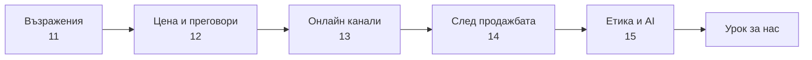

# Модул 16. Как продават големите 2: интегриран казус

## Цели на урока

След този модул ученикът може да:

* анализира как реална голяма компания се справя с възражения, цена и преговори, дигитални канали, обслужване след продажбата и етика;
* използва инструментите от модули 11 до 15 върху истински случаи;
* разпознае кога голяма компания е сгрешила и какво ѝ е струвало това;
* пренесе урок от голямата компания към проекта „Истинска продажба“ или към малък български бизнес.

Това е модулът, с който приключва вторият срок, преди финалната симулация. Първият интегриран казус (модул 10) гледаше как компаниите намират клиента и му създават стойност. Този гледа **трудните моменти**: възраженията, преговорите, онлайн каналите, отношенията след продажбата и етиката.

## 1. Рамка за анализ: 5 въпроса, 5 модула

| Модул | Въпрос към компанията |
|---|---|
| 11 | Какви са най-честите възражения на клиентите ѝ и как отговаря на тях? |
| 12 | Как определя цената? Какви преговори води: едностранни, двустранни, многостранни? |
| 13 | Как продава онлайн? Какво прави продуктът или съдържанието вместо продавача? |
| 14 | Какво се случва след покупката? Как пази или възстановява доверието? |
| 15 | Етично ли продава? Как използва данни и AI? |

## 2. Salesforce: когато клиентите възразяват срещу цената

**Възражението.** Когато Salesforce започва да продава AI агентите Agentforce, плащането е според използването. Всяко действие на агента струва пари. Големите клиенти възразяват: не могат да планират бюджета.

**Отговорът.** Компанията не сваля цената, а променя модела. Освен плащане на потребител и плащане според използването, предлага на големите клиенти договори с неограничено ползване за 2 до 3 години. Ръководител в компанията го обяснява така: клиентите не искат да броят токени, искат предвидимост.

**Свързано с:** модул 11 (причината зад възражението не е „скъпо“, а „непредвидимо“), модул 12 (интегративен преговор: клиентът получава сигурност, Salesforce получава дълъг договор).

## 3. Microsoft и Activision: четири страни на масата

Microsoft купува Activision Blizzard за 68,7 млрд. долара. Британският регулатор блокира сделката през април 2023 г. заради облачните игри. Microsoft преструктурира сделката: правата за облачно стрийминг на игрите на Activision извън Европейското икономическо пространство за 15 години отиват при Ubisoft. Регулаторът одобрява новата сделка през октомври 2023 г.

**Свързано с:** модул 12 (многостранен преговор, нова страна отключва споразумението, отстъпка в права вместо в цена).

## 4. Tesla и Anthropic: едностранни и тристранни сделки

**Tesla** продава колите си на една цена за всички, без пазарлък, директно, без дилъри. Това са едностранно определени условия: прозрачни, но без гъвкавост.

**Anthropic, Google и Broadcom** през април 2026 г. обявяват споразумение за изчислителна мощност: Broadcom прави чиповете, Google ги предоставя в облака си, Anthropic ги използва за Claude. Три страни, три различни интереса, едно споразумение.

**Свързано с:** модул 12 (видове преговори според броя на страните).

## 5. Lovable и Виктория Бекъм: онлайн, без класически продавач

**Lovable** продава почти без продавачи в началото: човек пробва безплатно, вижда резултат и плаща онлайн. Корпоративният екип се включва чак когато много хора в една компания вече ползват продукта.

**Виктория Бекъм** продава чрез съдържание: показва в TikTok как се гримира, какво се случва зад кулисите. Новият фон дьо тен тръгва със списък от 25 000 чакащи. Документалната поредица в Netflix показва и загубите на марката открито. През 2025 г. марката има първа оперативна печалба от 7,3 млн. паунда при приходи 129,8 млн., след 18 години загуби.

**Свързано с:** модул 13 (продуктът и съдържанието като продавач, кога е нужен човек).

## 6. Nike: възстановяване на доверието с партньорите

Между около 2020 и 2023 г. Nike се фокусира върху директните продажби, спира да продава в Amazon и намалява стоките си в магазините партньори. Те дават рафтовете на други марки. От 2024 г. новият главен изпълнителен директор Елиът Хил обявява, че компанията спира да се конкурира с партньорите си. Във финансовата 2026 г. продажбите през партньори растат с 6% до 27,5 млрд. долара, а директните падат с 6%.

**Свързано с:** модул 14 (план за възстановяване на доверие, но с бизнес партньори), модул 12 (дългосрочните отношения са по-ценни от една изгодна сделка).

## 7. Amazon Prime: колко струва тъмният модел

Това е пример за грешка. През юни 2023 г. американската Федерална търговска комисия (FTC) съди Amazon, че записва хора в абонамента Prime, без те да разбират, и прави отказването умишлено трудно. Според FTC пътят за отказ е бил 4 страници, 6 клика и 15 опции. Компанията го е сравнявала вътрешно с „Илиада“ на Омир.

През септември 2025 г. Amazon се съгласява да плати 2,5 млрд. долара: 1 млрд. глоба и 1,5 млрд. връщане на пари на около 35 млн. клиенти. Трябва и да опрости отказа от Prime. Amazon не признава вина.

**Свързано с:** модул 15 (тъмни модели), модул 14 (лесният отказ е част от доброто обслужване). Урок: манипулацията може да носи пари за години, но когато излезе наяве, струва и пари, и доверие.

## 8. Anthropic: безопасността като аргумент в продажбата

Anthropic изгражда марката си около безопасността на AI. За банки, болници и държавни институции това е продажбен аргумент: те трябва да знаят какво става с данните им и как се проверяват отговорите. Когато фирма продава с AI чатбот, клиентът трябва да знае, че говори с AI.

**Свързано с:** модул 15 (AI с човешка проверка, етиката като конкурентно предимство).

## Обобщение

| Компания | Модул | Урок |
|---|---|---|
| Salesforce | 11, 12 | промени модела, не цената, когато възражението е за предвидимост |
| Microsoft | 12 | нова страна може да отключи многостранен преговор |
| Tesla | 12 | една цена носи прозрачност, но губи гъвкавост |
| Anthropic, Google, Broadcom | 12 | всяка страна в сделката трябва да спечели нещо свое |
| Lovable | 13 | продуктът продава, човекът идва, когато клиентът е голям |
| Виктория Бекъм | 13 | съдържанието и честността продават |
| Nike | 14 | доверието на партньорите се губи бързо и се връща бавно |
| Amazon Prime | 14, 15 | тъмните модели излизат скъпо |
| Anthropic | 15 | етиката може да е причина клиентът да избере теб |

## Източници

* FTC и Jurist за делото срещу Amazon Prime, септември 2025; Fortune, септември 2025.
* Constellation Research и CX Today за Salesforce и Agentforce, 2026.
* UK Competition and Markets Authority, август и октомври 2023.
* Bloomberg за Anthropic, Google и Broadcom, април 2026.
* Financial Times, The Impression за Victoria Beckham Holdings, 2026.
* Nike, отчети за финансовата 2026 г.
