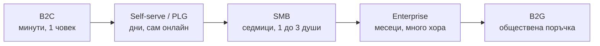

# Как продават големите: казуси за анализ

Тук са десет компании, които продават по много различен начин. Всеки казус следва една и съща схема: **кой е клиентът**, **на какво ниво се продава**, **как изглежда продажбата**, **какво можем да научим** и **въпроси за анализ**. Числата са от публични източници към 2026 г. Където източниците се разминават, го казваме.

## 1. Нивата на продажба: карта за ориентиране

Преди казусите ни трябва обща карта. Продажбите се различават според това **кой купува** и **колко сложно е решението**.

| Ниво | Кой купува | Как изглежда решението | Пример |
|---|---|---|---|
| **B2C (бизнес към потребител)** | един човек за себе си | бързо, често емоционално, малка сума | слушалки в Технополис |
| **Self-serve, PLG (самообслужване, растеж чрез продукта)** | човек или малък екип, сам, онлайн | пробва безплатно, плаща с карта, без продавач | Lovable, Spotify |
| **SMB (малък и среден бизнес)** | собственик или управител | няколко седмици, 1 до 3 души решават | счетоводна програма за кафене |
| **Enterprise (корпоративни продажби)** | голяма организация | месеци, 6 до 20 души решават, правен и ИТ отдел, пилотен проект | Salesforce, Anthropic за банка |
| **Channel (продажба чрез партньори)** | клиентът купува от посредник | продуктът стига до клиента през някой, на когото той вече вярва | Claude в AWS, Google Cloud и Microsoft; Nike в магазин за спортни стоки |
| **B2G (бизнес към държавата)** | държавна или общинска институция | обществена поръчка с правила и срокове | доставка на лаптопи за училища |

Колкото по-надясно, толкова по-голяма е сумата, по-дълъг е процесът и толкова повече хора трябва да бъдат убедени. Но умението в центъра е същото: да разбереш нуждата и да създадеш стойност.

## 2. Anthropic: от разработчика до корпорацията

**Какво продава.** Anthropic създава AI моделите Claude. Продава ги по няколко начина едновременно:

* **приложението Claude** с безплатен и платени планове за отделни хора (B2C и самообслужване);
* **планове за екипи и компании** (Claude for Team и Enterprise), с администриране, сигурност и контрол на данните (SMB и enterprise);
* **API за разработчици**, които вграждат Claude в свои продукти; плаща се според използването;
* **чрез облачните партньори** Amazon Bedrock, Google Cloud и Microsoft Foundry. Голяма компания, която вече има договор с Amazon, Google или Microsoft, добавя Claude към същата сметка и получава една фактура, без нов доставчик.

**Числата.** Според самата компания годишният темп на приходите е минал 30 млрд. долара в началото на април 2026 г., при около 9 млрд. в края на 2025 г. По данни на Bloomberg, цитирани в медиите, към края на юли 2026 г. темпът е около 65 млрд. долара. Около 80% от приходите идват от бизнес клиенти, а клиентите, които плащат над 1 млн. долара годишно, са над 1 000 към април 2026 г.

**Как изглежда продажбата.** Често започва отдолу: разработчик пробва API или Claude Code, екипът му започва да го ползва, после компанията иска общ договор със сигурност и контрол. Тогава се включват корпоративни продавачи, които работят с ИТ отдела, юристите и отдела за сигурност. Това е **land and expand (влез и разшири)**: първо малко, после повече.

**Какво можем да научим.**

* Едно и също нещо се продава различно на различни нива: на ученика с безплатен план, на банката с договор за сигурност.
* Доверието е част от продукта. За корпоративния клиент въпросът „Какво става с данните ни?“ е по-важен от „Колко е умен моделът?“.
* Партньорите намаляват риска и усилието за клиента: той купува от доставчик, на когото вече вярва.

**Въпроси за анализ.** Защо голяма банка би предпочела да купи Claude през облака, с който вече работи? Кои са хората, които трябва да кажат „да“ в такава компания? Какво е стойност за ИТ директора и какво за служителя, който ще ползва Claude всеки ден?

## 3. Lovable: продуктът продава сам

**Какво продава.** Шведската компания Lovable прави платформа, в която описваш приложение с думи и то се създава. Пусната е в края на ноември 2024 г.

**Числата.** Стига 100 млн. долара годишни повтарящи се приходи (ARR) около 8 месеца след старта, 200 млн. през ноември 2025 г. и 400 млн. през февруари 2026 г., със 146 служители. През август 2026 г. е оценена на 13,3 млрд. долара и според публикациите се използва в почти две трети от компаниите във Fortune 500.

**Как изглежда продажбата.** Почти без продавачи в началото. Това е **PLG, product-led growth (растеж, воден от продукта)**:

1. Човек пробва безплатно и вижда резултат за минути. Първото „уау“ е продажбата.
2. Споделя какво е направил. Всяко приложение, направено с Lovable, е реклама.
3. Когато иска повече, плаща абонамент с карта, без разговор.
4. Когато много хора в една компания го ползват, Lovable добавя **product-led sales (продажби, водени от продукта)**: корпоративен екип, който предлага сигурност, управление и интеграции, за да превърне отделните опити в договор за цялата компания. През 2026 г. компанията наема ръководител продажби с опит в HubSpot и Klaviyo.

Ръководителката на растежа Елена Верна казва, че даването на продукта безплатно работи по-добре от платената реклама и говори за **minimum lovable product (минимален продукт, който хората обичат)** вместо минимален работещ продукт.

**Какво можем да научим.**

* Понякога най-добрата продажбена презентация е клиентът да пробва сам.
* Безплатният план не е подарък, а първата стъпка от продажбения процес.
* Растежът не е безкраен: от 300 до 400 млн. стигат за месец, а от 400 до 500 за около четири. Продажбеният екип става нужен, когато клиентите стават по-големи.

**Въпроси за анализ.** Кой етап от продажбения процес от модул 01 е „автоматизиран“ при Lovable и кой не може да бъде? Защо компания от Fortune 500 няма да купи само с карта? Какво трябва да предложи продавачът ѝ?

## 4. Salesforce: корпоративната продажба като машина

**Какво продава.** CRM системи (за управление на клиентите), а от 2024 г. и AI агенти с името Agentforce.

**Как изглежда продажбата.** Класическа enterprise продажба: дълъг цикъл, много хора от страна на клиента, пилотни проекти, консултантски фирми като Accenture и Deloitte, които продават заедно със Salesforce. Голяма част от новите продажби идват от **съществуващи клиенти**, които разширяват договора си. Ценообразуването се променя: освен на потребител (seat), вече и според използването, а за големите клиенти има договори с неограничено ползване за 2 до 3 години, защото, както казват от компанията, клиентите искат предвидимост, не да броят токени.

През 2026 г. главният изпълнителен директор Марк Бениоф казва, че AI агенти обработват сами хиляди потенциални клиенти, но компанията продължава да наема продавачи, защото сключването на сделка все още изисква хора.

**Какво можем да научим.** AI поема подготовката и рутината, но доверието и преговорите остават човешка работа. Разширяването при стар клиент често е по-лесно от нов клиент.

**Въпроси за анализ.** Защо клиентът иска предвидима цена? Каква е разликата между продажба на нов клиент и разширяване при съществуващ?

## 5. Apple: магазинът като преживяване

**Какво продава.** Електроника, но в магазините си продава преди всичко преживяване: пробваш всичко свободно, никой не те гони, има безплатни уроци и сервиз на място.

**Как изглежда продажбата.** Консултантите в Apple Store не работят на комисиона от продажбата. Целта им е клиентът да си тръгне доволен, не да купи най-скъпото. Плащането става при консултанта, без опашка на каса.

**Какво можем да научим.** Когато продавачът не е притиснат да продаде, клиентът му вярва повече. Свържи с модул 07: продажба без натиск.

**Въпроси за анализ.** Какви са рисковете за бизнеса, ако продавачите нямат комисиона? Какви са ползите? Как би изглеждал магазин за телефони в твоя град по този модел?

## 6. Tesla: една цена за всички

**Какво продава.** Електрически автомобили, директно, без дилъри.

**Как изглежда продажбата.** Поръчката се прави онлайн или в шоурум на компанията. Цената е еднаква за всички купувачи в даден момент и няма пазарлък. Ако цената се промени, се променя за всички.

**Какво можем да научим.** Това е пример за **едностранно определени условия**: компанията задава цената, клиентът приема или отказва. Предимство: прозрачност, никой не се чувства прецакан. Недостатък: клиентът няма как да договори нищо и ако цената падне седмица след покупката, се чувства излъган. Сравни с модул 08.

**Въпроси за анализ.** Би ли предпочел да купиш кола с фиксирана цена или с пазарлък? Защо?

## 7. Nike: когато обидиш партньорите си

**Какво продава.** Спортни обувки и облекло.

**Какво се случи.** Между около 2020 и 2023 г. Nike решава да продава основно директно: собствен сайт, приложение и магазини (**DTC, direct to consumer**). Спира да продава в Amazon и намалява стоките си в много магазини партньори. Местата по рафтовете заемат по-нови марки като On и Hoka. От 2024 г. новият главен изпълнителен директор Елиът Хил, който е започнал в Nike като стажант в продажбите, връща компанията към партньорите. Във финансовата 2026 г. продажбите на едро растат с 6% до 27,5 млрд. долара, а директните падат с 6% до 17,7 млрд.

**Какво можем да научим.** Партньорите в продажбите (магазините, дистрибуторите) не са само канал, а взаимоотношение. Ако го развалиш, възстановяването отнема години. Свържи с модул 10: възстановяване на доверие.

**Въпроси за анализ.** Защо магазин като Sport Depot би предпочел да продава друга марка, ако Nike му дава по-малко стоки? Как би възстановил доверието на партньор, когото си изоставил?

## 8. IKEA и Amazon: продажба без продавач

**IKEA** е подредена така, че да продава сама: маршрут през шоурума, готови стаи, цени и размери на всеки етикет, склад на самообслужване. Продавачите са малко и помагат при сложните покупки (кухни, гардероби), където има консултация и проект.

**Amazon** продава без продавач изцяло онлайн: препоръки „клиентите купиха и“, отзиви, бърза доставка, лесно връщане. Отзивите и лесното връщане намаляват възприемания риск от модул 08.

**Какво можем да научим.** Продажбеният процес съществува и без човек, но някой трябва да го е проектирал. Въпросите, доказателствата и следващата стъпка са вградени в магазина или в сайта.

**Въпроси за анализ.** Кои етапи от продажбения процес IKEA е оставила на хора и защо точно тях? Кое в Amazon заменя „изясняването на потребността“?

## 9. Виктория Бекъм: от известно име до печеливша марка

**Какво продава.** Луксозна дамска мода (рокли, костюми, дънки, чанти) и козметика под марката Victoria Beckham Beauty. Марката е създадена през 2008 г.

**Числата.** 18 години компанията е на загуба. Натрупаните загуби стигат 69 млн. паунда до 2023 г., а на моменти Дейвид Бекъм влага пари, за да спаси бизнеса. През 2025 г. приходите растат с 15% до 129,8 млн. паунда, а компанията за пръв път има оперативна печалба: 7,3 млн. паунда, при загуба от 1,6 млн. година по-рано.

**Как продава и какво промени.**

* **Известното име не стига.** Години наред славата носи внимание, но не и печалба. Урок: доверието в човека не се превръща автоматично в покупка.
* **Директна продажба.** Марката продава все повече през собствения си сайт и магазина си на Dover Street в Лондон, за да задържи цялата печалба, вместо да я дели с универсални магазини. Продажбите на едро също растат, но вече не са единственият път.
* **Входен продукт.** Освен дрехи за хиляди паунда, марката добавя продукти около 100 паунда. Така хора, които мечтаят за марката, могат да купят първото си парче. Това е стълба на стойността: малка първа покупка, после по-голяма.
* **Списък на чакащите.** Фон дьо тен Foundation Drops за 104 паунда тръгва със списък от 25 000 души, чакащи да го купят. Ръководителката на козметиката казва, че продуктът е удвоил продажбите в категорията. Чакането създава желание, без да е нужна отстъпка.
* **Тя самата е продавачът.** В TikTok и Instagram Виктория показва как се гримира, какво се случва зад кулисите, как работи. Не реклама, а съдържание, което учи. Документалната поредица на Netflix от октомври 2025 г. показва трудностите на бизнеса открито, включително загубите, и според отчетите на компанията повишава продажбите, особено на дънки и трикотаж.
* **Дисциплина зад сцената.** Нови ръководители, сред тях Сибил Дарикаре Люнел, дошла от Dior, по-строг контрол на разходите и по-добри данни за продажбите.

**Какво можем да научим.**

* Личната марка отваря вратата, но продажбата изисква процес, правилен продукт и числа.
* Честността продава: когато показваш и трудностите, хората ти вярват повече.
* Входният продукт и списъкът на чакащите са два начина да намалиш риска на клиента и да увеличиш желанието, без да сваляш цената.

**Въпроси за анализ.** Защо 18 години слава не стигат за печалба? Какво печели марката, когато Виктория показва в TikTok как се гримира? Кой е входният продукт на любима твоя марка? Има ли български пример за човек, който продава чрез личната си марка?

## 10. Microsoft и Activision: преговор с много страни

**Какво се случи.** През 2022 г. Microsoft обявява, че купува компанията за игри Activision Blizzard (Call of Duty) за 68,7 млрд. долара. Сделката трябва да бъде одобрена от регулаторите в САЩ, ЕС и Обединеното кралство. Британският орган за конкуренция (CMA) блокира сделката през април 2023 г. заради притеснения за облачните игри. Microsoft преструктурира сделката: правата за облачно стрийминг на игрите на Activision извън ЕИП за 15 години отиват при друга компания, Ubisoft. След това CMA одобрява сделката през октомври 2023 г.

**Страните в преговора:** Microsoft, Activision, британският регулатор, Европейската комисия, американският регулатор, Ubisoft, а отстрани и конкурентът Sony. Това е **многостранен преговор**.

**Какво можем да научим.** В многостранния преговор решението, което удовлетворява всички, често включва нова страна (тук Ubisoft), която поема част от проблема. Отстъпката на Microsoft не е отстъпка в цената, а в правата.

**Въпроси за анализ.** Какъв беше интересът на всяка страна? Какво спечели и какво загуби Microsoft? Защо добавянето на четвърта страна отключи сделката?

## Обобщение: какво е общото

| Компания | Ниво | Главна сила | Урок за нас |
|---|---|---|---|
| Anthropic | от B2C до enterprise и партньори | доверие, сигурност, партньори | едно и също се продава различно на различни нива |
| Lovable | PLG и enterprise | продуктът продава сам | нека клиентът пробва |
| Salesforce | enterprise | разширяване при стари клиенти | AI помага, човекът сключва |
| Apple | B2C | преживяване без натиск | доверие преди продажба |
| Tesla | B2C | една цена | прозрачност, но без гъвкавост |
| Nike | партньори и DTC | марка | не разваляй отношенията с партньорите |
| IKEA, Amazon | самообслужване | проектиран процес | процесът може да е вграден |
| Victoria Beckham | луксозна мода и козметика, директно | личната марка, входен продукт, списък на чакащите | славата отваря вратата, процесът продава |
| Microsoft | сделка с много страни | преструктуриране | нова страна може да отключи преговора |

## Източници

* Anthropic, съобщение за темпа на приходите, април 2026; Bloomberg, Reuters, август 2026.
* TechCrunch за Lovable, март и юли 2025, март 2026; AI Magazine, август 2026; Lenny's Newsletter, интервю с Елена Верна.
* Salesforce, отчети за финансовата 2026 г.; CX Today, май 2026.
* Nike, отчети за финансовата 2026 г.; Retail Touchpoints, SGI Europe.
* Financial Times, The Industry, The Impression за Victoria Beckham Holdings, август и септември 2026.
* UK Competition and Markets Authority, съобщения от август и октомври 2023.
