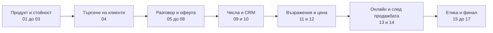

# Проект „Истинска продажба“

През годината класът продава истински продукт или услуга на истински клиенти. Всеки модул добавя едно умение към проекта. Накрая анализирате числата си и представяте резултата пред жури.

## Какво продаваме

Учителят одобрява един от вариантите:

* **Продукт на ученическа фирма:** нещо, което класът прави (картички, снимки на продукти, дизайн на менюта, уроци по програма за по-малки ученици).
* **Продукт на партньор:** фирма от стажантската програма или местен бизнес, който дава продукт за продажба срещу комисиона за класа.
* **Благотворителна кампания:** продажба на училищен базар, приходите отиват за кауза, избрана от класа.

Правила: всичко е честно, без натиск; продаваме само на хора, които сами решат; никакви лични данни извън нужното; всеки контакт навън е одобрен от учителя.

## Как проектът минава през модулите

| Модул | Какво добавяте към проекта |
|---|---|
| 01 | Избирате продукта и описвате стойността за клиента и за класа. |
| 02 | Клиентски профили на 2 до 3 типа клиенти. |
| 03 | Как ще използвате етично принципите на влиянието (мостра, отзиви, ясна цена). |
| 04 | ICP, списък с 20 потенциални клиенти, студени съобщения, квалифициране по BANT. |
| 05 | Сценарий за първия контакт на живо, в чат и по имейл. |
| 06 | Въпроси по SPIN за първия разговор. |
| 07 | 60-секундно стойностно предложение с доказателства. |
| 08 | Писмена оферта на една страница. |
| 09 | CRM на класа и табло с фунията. Обновява се всяка седмица. |
| 10 | Сравнявате подхода си с този на голяма компания от интегрирания казус. |
| 11 | Банка с чутите възражения и отговорите, които работят. |
| 12 | Ценова политика, кога има отстъпка и срещу какво. |
| 13 | Канали онлайн: страница, публикации, отговори на запитвания. |
| 14 | Последващ контакт с всеки клиент и молба за отзив. |
| 15 | Проверка на етиката и данните в целия проект. |
| 16 | Сравнявате кампанията си с голяма компания във втория интегриран казус. |
| 17 | Финален анализ и представяне пред жури. |

## Седмичен ритъм

* **Понеделник:** всеки обновява сделките си в CRM.
* **В часа:** 10 минути преглед на таблото с фунията. Къде губим хора и защо?
* **Задача за седмицата:** едно конкретно действие на човек (3 разговора, 2 оферти, 1 последващ контакт).

## Роли в екипа

| Роля | Отговорност |
|---|---|
| SDR (търсене на клиенти) | списък с потенциални клиенти, студени съобщения, квалифициране |
| Account Executive (продавач) | разговори, оферти, преговори |
| Customer Success (грижа за клиента) | доставка, последващ контакт, отзиви |
| Анализатор | CRM, табло, седмичен отчет |
| Мениджър | планира, следи целта, води срещите |

Ролите се сменят веднъж на срок, така че всеки опитва поне две.

## Финално представяне

Всеки екип има 7 минути пред жури (учители, родители, гости от бизнеса) и 3 минути за въпроси.

1. Какво продадохме и на кого.
2. Фунията ни: числата от първия контакт до сделката.
3. Най-трудното възражение и как го решихме.
4. Една грешка и какво научихме от нея.
5. Какво бихме направили различно с още един месец.

### Критерии

| Критерий | 0 т. | 2 т. | 4 т. |
|---|---|---|---|
| Резултат спрямо целта | няма цел или данни | частично постигната, обяснено защо | постигната или надмината |
| Качество на данните в CRM | няма или е непълна | пълна, но не е обновявана редовно | пълна и обновявана всяка седмица |
| Анализ на фунията | само общ брой | процентите по етапи | процентите, причините и действията |
| Етика | има натиск или подвеждане | без нарушения | ясно показана честност към клиентите |
| Представяне | неясно, над времето | ясно | ясно, с доказателства, отговаря уверено на въпроси |
| Самооценка | „справихме се добре“ | назовава слабост | назовава причина и конкретно действие |

Максимум: 24 точки. Индивидуалната оценка взима предвид и портфолиото на всеки ученик.
